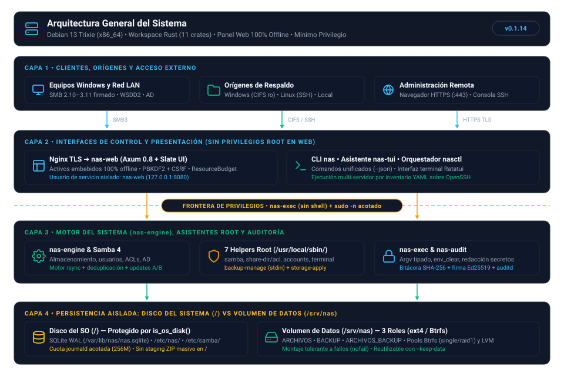

# NAS Debian 13 & Central de Respaldos Multiplataforma

<div align="center">


**Plataforma nativa en Rust sobre Debian 13 (`x86_64`) para servidores departamentales SMB/CIFS, centralización de respaldos deduplicados Windows/Linux y administración web sin dependencias en la nube.**

</div>

---

## Qué Resuelve

- **Compartición de archivos para oficinas (+100 puestos):** Samba 4 optimizado (`SMB2_10`–`SMB3_11`, firma obligatoria, módulos VFS `acl_xattr`, `streams_xattr` y papelera `.recycle`) con ACLs POSIX heredables por grupo para evitar bloqueos en Excel/Office.
- **Central de copias de seguridad multiplataforma:** respaldo automatizado de carpetas compartidas Windows (`mount.cifs` SMB 3.1.1 en solo lectura) y servidores Linux (`SSH` con `rsync -aAXH --numeric-ids`), staging atómico `.inprogress_*`, deduplicación por *hardlinks* (`--link-dest`) y *Golden Snapshots*.
- **Operación 100% offline y consumo mínimo:** binario único `nas-web` (`axum` + SQLite WAL) detrás de Nginx TLS con visores locales de ofimática (`.xlsx`, `.docx`, `.pptx`) e inspector de comprimidos (`.rar` vía WASM local, `.zip`), terminal PTY por usuario (`tmux`), CLI unificado (`nas`), TUI (`nas-tui`) y orquestador multi-host (`nasctl`).
- **Seguridad por mínimo privilegio:** el panel web corre como usuario sin privilegios (`nas-web`) delegando acciones privilegiadas a 7 helpers acotados en `sudoers`, con auditoría encadenada SHA-256 (`nas-audit`) y protección en código del disco del sistema operativo (`is_os_disk()`).

---

## Arquitectura y Roles del Servidor



El comando `nas deploy apply` adapta el almacenamiento (`/srv/nas`), los recursos compartidos y el mantenimiento automático a **3 roles**:

| Rol | Uso Principal | Filesystem por Defecto | Comportamiento Clave |
| :--- | :--- | :--- | :--- |
| **`ARCHIVOS`** | NAS departamental (`SRV-NAS`) | **`ext4`** (admitido `--btrfs`) | Recursos visibles por departamento, ACLs `2770` heredables, papelera de red `.recycle` y montaje resiliente (`commit=5`, `errors=remount-ro`, `nofail`). |
| **`BACKUP`** | Central de respaldos (`SRV-BKP`) | **`Btrfs`** (admitido `--ext4`) | Directorios `BACKUPS_HISTORICOS`, `BACKUPS_PERMANENTES` y `LOGS_BACKUP`, compresión `zstd:3`, *scrub* mensual anti *Bit Rot* y deduplicación `rsync --link-dest`. |
| **`ARCHIVOS_BACKUP`** | Nodo híbrido unificado | **`Btrfs`** (admitido `--ext4`) | Combina compartición departamental y central de respaldos sobre el mismo servidor. |

---

## Requisitos de Infraestructura

- **Sistema operativo:** instalación limpia de **Debian 13 (Trixie) `x86_64`** con acceso `root`/`sudo` y red LAN estable.
- **Almacenamiento separado:** disco dedicado recomendado para `/srv/nas` (protegido contra formateos accidentales del disco raíz mediante `is_os_disk()`).
- **Resiliencia eléctrica (crítico en hardware consumidor):** en producción sobre SSD/HDD de grado consumidor es **obligatorio contar con UPS/No-Break** (preferiblemente integrado con `nut` o `apcupsd`) y se recomienda RAID-1 o SSD con PLP (*Power Loss Protection*) para `/`, reduciendo el riesgo de corrupción FTL o bloqueo en solo lectura tras cortes de energía.

---

## Inicio Rápido

### 1. Instalar la plataforma (`install.sh`)

```bash
curl -fsSL https://raw.githubusercontent.com/ftole/nas_debian/main/install.sh | sudo bash
```

O compilar desde código fuente en un repositorio local:

```bash
sudo bash install.sh --build-from-source
```

### 2. Aprovisionar disco, rol y Samba (`nas deploy apply`)

```bash
# Servidor departamental ARCHIVOS sobre disco dedicado /dev/sdb
sudo nas deploy apply \
  --disk /dev/sdb \
  --role ARCHIVOS \
  --workgroup TEAM-JOFRATO \
  --netbios SRV-NAS \
  --admin admin

# Central BACKUP en SSD reutilizando partición Btrfs existente (--keep-data)
sudo nas deploy apply \
  --disk /dev/sdb \
  --role BACKUP \
  --ssd \
  --keep-data \
  --workgroup TEAM-JOFRATO \
  --netbios SRV-BKP \
  --admin admin
```

Al terminar, accede a `https://<IP-del-servidor>` (la contraseña temporal generada se guarda una única vez en `/etc/nas/.initial_admin_password`) y completa el checklist de endurecimiento de host (`UFW`, SSH, `fail2ban`, `AIDE`) en **[docs/manual.md](./docs/manual.md)**.

---

## Interfaces Disponibles

| Interfaz | Comando / Acceso | Público Objetivo |
| :--- | :--- | :--- |
| **Panel Web Slate UI** | `https://<IP-del-servidor>` | Administración diaria, archivos Drag & Drop, visores ofimáticos offline, terminal PTY y respaldos. |
| **CLI Unificado (`nas`)** | `nas <subcomando> [--json]` | Automatización, scripts y diagnóstico (`status`, `storage`, `backup`, `audit`, `update`, `deploy`). |
| **Asistente Terminal** | `sudo nas-tui` | Operación visual interactiva por consola local o SSH. |
| **Orquestador Multi-Host** | `nasctl --inventory inventory.yaml` | Ejecución remota controlada sobre flotas por SSH. |

---

## Seguridad, Madurez y Deuda Técnica

La plataforma utiliza Rust con `#![forbid(unsafe_code)]`, `CommandSpec` sin intérprete de shell, autenticación `PBKDF2-HMAC-SHA512`, tokens anti-CSRF `HMAC-SHA256`, rate limiting en SQLite y actualizaciones firmadas con `Ed25519`. Para transparencia operativa, consulta las brechas vigentes, bugs conocidos y plan de corrección en:
- **[docs/seguridad.md](./docs/seguridad.md)** — Controles automatizados vs endurecimiento manual requerido.
- **[docs/deuda_tecnica.md](./docs/deuda_tecnica.md)** — Auditoría código por código y plan de remediación activo (`v0.1.12+`).

---

## Documentación

### Operación y Seguridad (Administradores)
- **[Manual Operativo y Diagnóstico](./docs/manual.md)** — Instalación, administración por perfiles, mantenimiento, recuperación y matriz FMEA.
- **[Seguridad y Endurecimiento](./docs/seguridad.md)** — Modelo de privilegios, checklist Debian 13, requisitos UPS/PLP y automatización proyectada.

### Ingeniería y Desarrollo (Contribuidores)
- **[Arquitectura del Sistema](./docs/arquitectura.md)** — Diseño de los 11 crates, `nas-web`, 7 helpers root y pipeline de respaldos.
- **[Stack Tecnológico y Glosario](./docs/tecnologias.md)** — Tecnologías integradas, parámetros clave y glosario de siglas.
- **[Laboratorio, CI y Releases](./docs/lab_y_desarrollo.md)** — Trabajo paralelo con `git worktree`, `scripts/deploy_local.sh`, puertas CI y releases `Ed25519`.
- **[Contrato de Agentes y Desarrolladores](./AGENTS.md)** — Reglas de commits atómicos, protecciones de hardware y guardrails obligatorios.

### Calidad, Histórico y Propuestas
- **[Deuda Técnica Activa](./docs/deuda_tecnica.md)** — Hallazgos actuales código por código y olas de remediación.
- **[Auditoría Base Histórica (`0f7a272`)](./docs/auditoria.md)** — Línea base histórica de la migración a Rust.
- **[RFC: Propuesta UX de Usuarios](./docs/propuesta_ux_usuarios.md)** — Especificación conceptual de rediseño UX (pendiente de implementación).

<details>
<summary>Diagramas vectoriales incluidos en <code>docs/assets/</code></summary>

- [arquitectura_general.svg](./docs/assets/arquitectura_general.svg) — Capas del sistema, frontera de privilegios y almacenamiento.
- [workspace_crates.svg](./docs/assets/workspace_crates.svg) — Tabla visual del workspace Rust (11 crates).
- [frontera_privilegios.svg](./docs/assets/frontera_privilegios.svg) — Flujo `nas-exec`/`sudo -n` y tabla de los 7 helpers root.
- [roles_almacenamiento.svg](./docs/assets/roles_almacenamiento.svg) — Matriz comparativa de los 3 roles (`ARCHIVOS`, `BACKUP`, `ARCHIVOS_BACKUP`).
- [modelo_seguridad.svg](./docs/assets/modelo_seguridad.svg) — Controles automáticos vs endurecimiento manual.
- [flujo_backups.svg](./docs/assets/flujo_backups.svg) — Pipeline `stdin`, `flock`, umbral híbrido, staging y retención.
- [flujo_autenticacion_y_privilegios.svg](./docs/assets/flujo_autenticacion_y_privilegios.svg) — Flujo HTTPS, `PBKDF2`/`CSRF`, `sudoers` y 7 helpers root.
- [ciclo_release_y_actualizacion.svg](./docs/assets/ciclo_release_y_actualizacion.svg) — Puertas CI, firma `Ed25519`, slots A/B y rollback.
- [entorno_lab_worktrees.svg](./docs/assets/entorno_lab_worktrees.svg) — Laboratorio multi-agente con `git worktree`.

</details>
