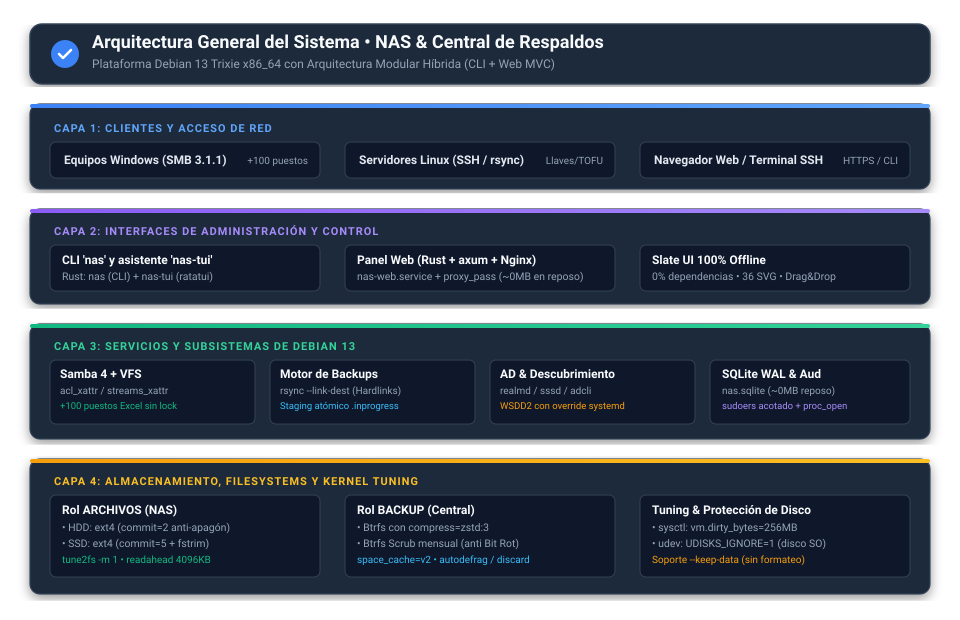

# Servidor NAS & Central de Respaldos Multiplataforma (Debian 13)

<div align="center">


-000000?style=for-the-badge&logo=rust&logoColor=white)


**Solución integral en Rust sobre Debian 13 (`x86_64`) para compartición departamental Samba, central de respaldos deduplicados y administración web 100% offline.**

</div>

---

## Arquitectura en Breve

La plataforma (`0.1.10`) se compone de un **workspace Rust de 11 crates** (`#![forbid(unsafe_code)]`) respaldado por SQLite en modo WAL, ejecución tipada sin shell (`nas-exec`), auditoría encadenada SHA-256 (`nas-audit`), un asistente de terminal (**`nas-tui`**), CLI unificado (**`nas`**), orquestador multi-host (**`nasctl`**) y un panel web en **`axum` 0.8 + Nginx TLS** con **Slate UI 100% offline** (**52 iconos SVG**, 28 módulos JS + 3 librerías *vendor* locales y 14 vistas de navegación).



---

## Los 3 Roles del Servidor

El comando `nas deploy apply` adapta el almacenamiento (`/srv/nas`), los recursos compartidos y el mantenimiento automático a **3 roles oficiales**:

| Rol | Uso Principal | Sistema de Archivos por Defecto | Características Clave |
| :--- | :--- | :--- | :--- |
| **`ARCHIVOS`** | Servidor NAS departamental (`SRV-NAS`) | **`ext4`** (override `--btrfs`) | Carpetas visibles, `commit=2` (HDD) / `commit=5` (SSD), `tune2fs -m 1`, ACLs POSIX `2770` + herencia por defecto, VFS `acl_xattr` + `streams_xattr` + `.recycle`, `fstrim.timer`. |
| **`BACKUP`** | Central de respaldos (`SRV-BKP`) | **`Btrfs`** (override `--ext4`) | Directorios `/srv/nas/BACKUPS_HISTORICOS`, `BACKUPS_PERMANENTES` y `LOGS_BACKUP` (`2770`), compresión `zstd:3`, *scrub* mensual anti *Bit Rot*, `rsync --link-dest` (>85% deduplicación), staging `.inprogress_*`, *Golden Snapshots*. |
| **`ARCHIVOS_BACKUP`** | Nodo híbrido unificado | **`Btrfs`** (override `--ext4`) | Combina recursos compartidos departamentales con la central de respaldos y mantenimiento Btrfs automático en un único servidor. |

Todos los roles cuentan con protección en código del disco del sistema operativo (**`is_os_disk()`**) y soporte de reutilización de particiones existentes sin formatear mediante **`--keep-data`**.

---

## Instalación y Puesta en Marcha

### 1. Instalar la plataforma Rust (`install.sh`)

```bash
curl -fsSL https://raw.githubusercontent.com/ftole/nas_debian/main/install.sh | sudo bash
```

O compilar desde el código fuente del repositorio local:

```bash
sudo bash install.sh --build-from-source
```

### 2. Aprovisionar disco, rol y Samba (`nas deploy apply`)

```bash
# Ejemplo: servidor departamental ARCHIVOS sobre /dev/sdb
sudo nas deploy apply \
  --disk /dev/sdb \
  --role ARCHIVOS \
  --workgroup TEAM-JOFRATO \
  --netbios SRV-NAS \
  --admin admin

# Ejemplo: central BACKUP sobre SSD reutilizando partición existente (--keep-data)
sudo nas deploy apply \
  --disk /dev/sdb \
  --role BACKUP \
  --ssd \
  --keep-data \
  --workgroup TEAM-JOFRATO \
  --netbios SRV-BKP \
  --admin admin
```

> [!NOTE]
> Tras completar la instalación, accede al panel web en `https://<IP-del-servidor>` (la contraseña inicial generada se guarda temporalmente en `/etc/nas/.initial_admin_password`) y consulta el checklist de endurecimiento manual de Debian 13 (`UFW`, SSH, `fail2ban`, `AIDE`) en [docs/manual.md](./docs/manual.md).

---

## Interfaces de Operación

- **Panel Web (`nas-web` + Nginx TLS):** 14 vistas operativas + `/audit`, explorador Drag & Drop (ZIP hasta 50 GiB), visores ofimáticos 100% offline (`.xlsx`, `.docx`, `.pptx`) y Terminal PTY real sobre `tmux`.
- **CLI Unificado (`nas`):** `status`, `network`, `services`, `diag`, `storage`, `users`, `backup`, `audit`, `update`, `deploy`, `uninstall` con soporte `--json`.
- **Asistente Visual de Terminal (`nas-tui`):** 12 secciones interactivas desde consola local o SSH.
- **Multi-Host (`nasctl`):** ejecución remota por inventario YAML (`inventory.yaml`) sobre transporte OpenSSH.

---

## Mapa de Documentación Técnica (`docs/`)

La documentación del proyecto está consolidada en **7 documentos** y **7 diagramas SVG** en `docs/assets/`:

| Documento | Contenido |
| :--- | :--- |
| [docs/arquitectura.md](./docs/arquitectura.md) | Workspace Rust (11 crates), 3 roles, 7 helpers root, backend `axum`, frontend modular Slate UI (28 JS + 3 vendor, 52 SVG), SQLite WAL, `is_os_disk()` y doble vía `packaging/` vs `nas deploy`. |
| [docs/tecnologias.md](./docs/tecnologias.md) | Explicación clara de todo el stack tecnológico, beneficios operativos y glosario integrado de siglas en inglés y español (`SMB2_10..SMB3_11`, `PBKDF2-HMAC-SHA512`, `Btrfs`, `rsync`, `WSDD2`, etc.). |
| [docs/seguridad.md](./docs/seguridad.md) | Controles automáticos implementados (`PBKDF2`, CSRF `HMAC-SHA256`, rate limit, `/api/files/raw`, sanitizador `.xlsx`, `NoNewPrivileges=no` + capacidades, `stdin`, `nas-audit`, `Ed25519`), endurecimiento manual Debian 13 y brechas abiertas. |
| [docs/manual.md](./docs/manual.md) | Manual operativo por perfiles, uso de `nas` / `nas-tui` / 14 vistas web, mantenimiento periódico, endurecimiento manual paso a paso, diagnóstico y matriz FMEA. |
| [docs/lab_y_desarrollo.md](./docs/lab_y_desarrollo.md) | Preparación del laboratorio `/opt/dev`, `git worktree` + `CARGO_TARGET_DIR`, `scripts/deploy_local.sh`, las 5 puertas CI locales, `scripts/package.sh`, firmas `Ed25519` y actualización atómica A/B con rollback. |
| [docs/auditoria.md](./docs/auditoria.md) | Auditoría técnica código vs. documentación sobre `main` (`0f7a272`) con evidencia de líneas y estado real de los hallazgos abiertos. |
| [docs/propuesta_ux_usuarios.md](./docs/propuesta_ux_usuarios.md) | Propuesta de diseño UX para segmentación por pestañas, tags/chips de grupos, vista previa de accesos Samba y matriz interactiva. |

### Diagramas Vectoriales (`docs/assets/`)

- [arquitectura_general.svg](./docs/assets/arquitectura_general.svg) — Capas del sistema, workspace y almacenamiento.
- [roles_almacenamiento.svg](./docs/assets/roles_almacenamiento.svg) — Matriz de los 3 roles (`ARCHIVOS`, `BACKUP`, `ARCHIVOS_BACKUP`).
- [modelo_seguridad.svg](./docs/assets/modelo_seguridad.svg) — Controles automáticos vs endurecimiento manual Debian 13.
- [flujo_backups.svg](./docs/assets/flujo_backups.svg) — Pipeline `install-spec`, `flock`, staging `.inprogress_*` y retención.
- [flujo_autenticacion_y_privilegios.svg](./docs/assets/flujo_autenticacion_y_privilegios.svg) — Flujo HTTPS, `PBKDF2`/`CSRF`, `sudoers` y 7 helpers root.
- [ciclo_release_y_actualizacion.svg](./docs/assets/ciclo_release_y_actualizacion.svg) — 5 puertas CI, firma `Ed25519`, slots A/B y rollback.
- [entorno_lab_worktrees.svg](./docs/assets/entorno_lab_worktrees.svg) — Flujo de laboratorio multi-agente con `git worktree` y `deploy_local.sh`.
