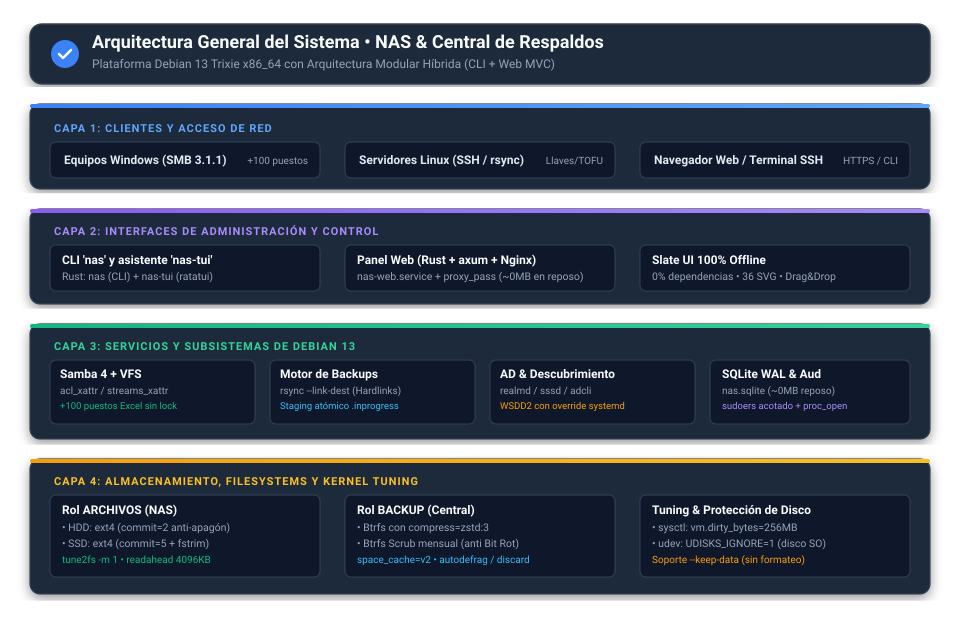
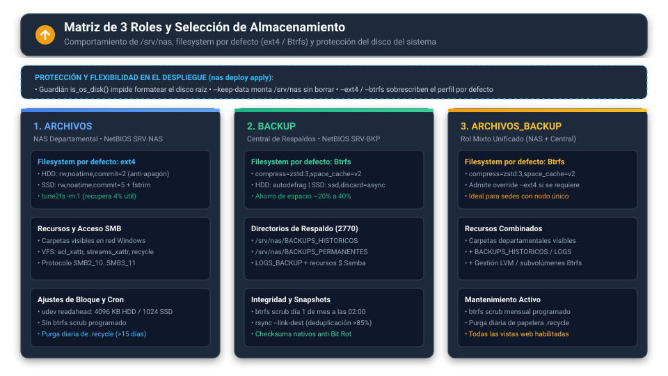
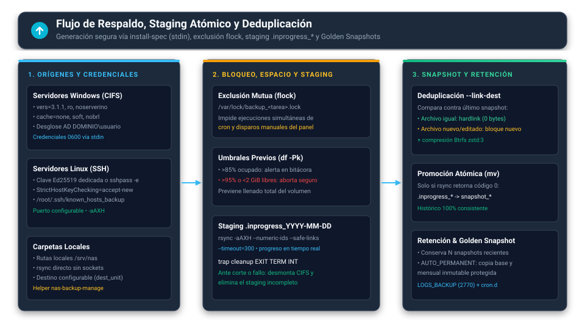

# Arquitectura del Sistema

> [!NOTE]
> Documento técnico actualizado respecto al estado real del repositorio (`main` `0f7a272`, plataforma Rust `0.1.10` sobre Debian 13 Trixie `x86_64`).

El sistema **NAS & Central de Respaldos Multiplataforma** está construido como un **workspace de Rust con 11 crates**, un backend HTTP en **`axum` 0.8** servido detrás de **Nginx**, una interfaz web **Slate UI 100% offline** con recursos embebidos en el binario, un asistente interactivo de terminal (**`nas-tui`**) y **7 helpers privilegiados** ejecutados bajo reglas estrictas de `sudoers`.

---

## 1. Visión de Alto Nivel por Capas

1. **Capa 1 — Clientes y Orígenes de Red:**
   - **Equipos Windows:** acceso por SMB/CIFS (*Server Message Block / Common Internet File System*) con protocolo negociado entre **`SMB2_10` y `SMB3_11`**, firma obligatoria (`server signing = mandatory`) y cifrado preferido (`smb encrypt = desired`).
   - **Orígenes de respaldo:** servidores Windows mediante montaje temporal `mount.cifs` (`vers=3.1.1`), servidores Linux por `SSH` (clave Ed25519 dedicada o `sshpass -e`) y rutas locales en `/srv/nas`.
   - **Administración:** navegador web por HTTPS (`Nginx` -> `127.0.0.1:8080`), consola local/SSH (`nas` CLI y `nas-tui`) y orquestación multi-nodo (`nasctl`).
2. **Capa 2 — Interfaces de Control (`nas-web`, `nas-cli`, `nas-tui`, `nasctl`):**
   - El panel web `nas-web` corre como servicio `systemd` dedicado bajo el usuario sin privilegios `nas-web`.
   - El CLI `nas` expone subcomandos tipados con salida humana o `--json` (`{success, message, data}`).
   - El asistente `nas-tui` (`ratatui`) ofrece 12 secciones de navegación en terminal (`Dashboard`, `Network`, `Shares`, `Users`, `Backups`, `Services`, `Diagnostics`, `Storage`, `Files`, `Domain`, `Terminal` y `Quit`).
3. **Capa 3 — Motor del Sistema (`nas-engine`), Ejecución Segura (`nas-exec`) y Auditoría (`nas-audit`):**
   - Toda operación del sistema se encapsula en `CommandSpec` (arreglo explícito `argv`, sin invocar `/bin/sh -c`), con `env_clear()`, timeouts acotados y redacción automática de secretos.
   - Las operaciones que requieren `root` atraviesan `sudo -n` hacia los **7 helpers de `/usr/local/sbin/`** o binarios autorizados en `/etc/sudoers.d/nas-web-rust`.
   - La trazabilidad combina `web_audit` en SQLite con `nas-audit` (bitácora *append-only* encadenada con hashes SHA-256).
4. **Capa 4 — Almacenamiento, 3 Roles y Tuning Debian 13:**
   - Gestión de `/srv/nas` según los 3 roles (`ARCHIVOS`, `BACKUP`, `ARCHIVOS_BACKUP`), protección de disco del sistema en código mediante `is_os_disk()`, reglas `sysctl` (`99-nas-tuning.conf`), `udev` (`60-nas-readahead.rules`) y auditoría kernel (`auditd`).

---

## 2. Inventario del Workspace Rust (11 Crates)

Todos los crates del workspace (`Cargo.toml` versión `0.1.10`, edición Rust `2021`, MSRV `1.80`) prohíben el uso de código inseguro (`unsafe_code = "forbid"`).

| Crate | Tipo | Responsabilidad Principal |
| :--- | :--- | :--- |
| `nas-core` | Librería | Tipos base, envoltorio `ApiResponse`, errores `NasError`, rutas `NasPaths`, roles (`ServerRole`) y saneamiento de argumentos (`shell::quote_all`). |
| `nas-exec` | Librería | Ejecutor `Runner` con `CommandSpec`, arreglo `argv` tipado, limpieza de entorno (`env_clear()`), timeouts, soporte `stdin` y modo `SudoMode`. |
| `nas-audit` | Librería | Bitácora de auditoría *append-only* con encadenamiento criptográfico SHA-256 verificable y verificación de cadena. |
| `nas-inventory` | Librería | Parseo y validación de inventarios YAML multi-servidor (`inventory.yaml`) y perfiles (`dev`/`prod`). |
| `nas-ssh` | Librería | Transporte remoto OpenSSH con verificación estricta de huellas de host y llaves dedicadas. |
| `nas-engine` | Librería | Lógica de negocio y sistema: almacenamiento (`storage`, `storage_ops`, `is_os_disk`), Samba, usuarios, respaldo (`backup`, `backup_spec`), dominio AD (`realmd`/`sssd`), servicios, diagnósticos, actualizaciones firmadas `Ed25519`, despliegue (`deploy/*`) y helpers (`helpers/*`). |
| `nas-cli` | Binario (`nas`) | CLI unificado con subcomandos (`status`, `network`, `services`, `diag`, `audit`, `migrate`, `backup`, `update`, `deploy`, `storage`, `uninstall`, `users`, `helper`, `daemon`), symlink `nas-cli -> nas`. |
| `nas-web` | Binario (`nas-web`) | Servidor HTTP `axum` 0.8 en `127.0.0.1:8080`, SQLite en modo WAL, autenticación `PBKDF2-HMAC-SHA512`, protección CSRF y activos frontend embebidos en el binario. |
| `nas-tui` | Binario (`nas-tui`) | Asistente interactivo de terminal basado en `ratatui` + `crossterm` con 12 secciones operativas. |
| `nasctl` | Binario (`nasctl`) | Orquestador multi-host sobre `inventory.yaml` usando `nas-inventory` y `nas-ssh`. |
| `nas-dev` | Binario (`nas-dev`) | Utilidad interna de sincronización y compilación para el entorno de desarrollo. |

---

## 3. Roles del Servidor y Almacenamiento

El sistema soporta **3 roles oficiales** definidos en `ServerRole` (`ARCHIVOS`, `BACKUP` y `ARCHIVOS_BACKUP`), persistidos en `/etc/nas/role`.

| Rol | Uso Previsto | Sistema de Archivos por Defecto | Opciones y Mantenimiento Clave |
| :--- | :--- | :--- | :--- |
| **`ARCHIVOS`** | Servidor NAS departamental (`SRV-NAS`) con carpetas visibles en red y alta concurrencia (+100 puestos). | **`ext4`** (sobreescribible con `--btrfs`) | `rw,noatime,commit=2` (HDD) / `commit=5` (SSD); `tune2fs -m 1` (recupera 4% de espacio reservado); `readahead` `4096 KB` (HDD) / `1024 KB` (SSD); `fstrim.timer` en SSD; purga diaria de `.recycle` (>30 días). |
| **`BACKUP`** | Central de respaldos (`SRV-BKP`) con recursos administrativos ocultos (`BACKUPS$`, `LOGS_BACKUP`). | **`Btrfs`** (sobreescribible con `--ext4`) | `compress=zstd:3,space_cache=v2`; `autodefrag` en HDD / `ssd,discard=async` en SSD; tarea mensual `nas-btrfs-scrub` (día 1 a las 02:00) para prevenir *Bit Rot*; deduplicación `rsync --link-dest`. |
| **`ARCHIVOS_BACKUP`** | Nodo híbrido unificado que combina recursos departamentales compartidos y repositorio de respaldos. | **`Btrfs`** (sobreescribible con `--ext4`) | Combina recursos visibles y ocultos (`BACKUPS$`), compresión `zstd:3`, *scrub* mensual automático y soporte completo de subvolúmenes Btrfs y volúmenes LVM desde el panel. |

### Protección del Disco del Sistema Operativo (`is_os_disk`) y `--keep-data`

- **Protección en código (`is_os_disk`):** Tanto el inventario (`crates/nas-engine/src/storage.rs`) como las operaciones de particionado y despliegue (`storage_ops.rs`, `deploy/storage.rs`) identifican el disco que aloja `/` o `/boot` consultando particiones montadas y árbol `lsblk`, marcándolo como `protected = true` e impidiendo formatearlo. No depende de reglas `udisks2` externas (`80-udisks2-hide-os.rules` no se instala en el sistema actual).
- **Reutilización sin pérdida (`--keep-data`):** Permite reaprovisionar el sistema operativo y reutilizar una partición `ext4` o `Btrfs` preexistente montándola en `/srv/nas` sin formatear (requiere indicar un disco dedicado en `/dev/...`, nunca `LOCAL`).

---

## 4. Arquitectura del Panel Web (`nas-web`) y Frontend Slate UI

### 4.1 Backend HTTP (`axum` + SQLite WAL)

El binario `nas-web` escucha únicamente en `127.0.0.1:8080` detrás de `Nginx` (TLS 1.2/1.3, `client_max_body_size 50G`). Sus rutas se organizan por dominio mediante routers independientes ensamblados con `.merge()` en `crates/nas-web/src/lib.rs`:

- `routes/auth.rs`: inicio y cierre de sesión, sesión actual, CSRF y rotación de contraseña.
- `routes/pages.rs`: renderizado de vistas HTML, resumen de dashboard, auditoría, bitácora y métricas en vivo.
- `routes/shares.rs`, `users.rs`, `backups.rs`, `storage.rs`, `files.rs`, `services.rs`, `network.rs`, `domain.rs`, `terminal.rs`, `system.rs`: API JSON `/api/*` bajo middleware de cabeceras HTTP de seguridad y extractors escalonados (`AuthenticatedUser`, `AdminUser`, `SuperAdminUser`).

La persistencia de estado vive en **SQLite en modo WAL (*Write-Ahead Logging*)** en `/var/lib/nas/nas.sqlite` (`crates/nas-web/src/db.rs`), con cuatro tablas principales:
- `web_users` (`username`, `password_sha256` que almacena hashes `$pbkdf2-sha512$` o SHA-256 heredado con auto-actualización al autenticar, `role`, `created_at`).
- `web_sessions` (`id`, `username`, `role`, `created_at`, `expires_at`, `ip`).
- `web_audit` (`id`, `timestamp`, `username`, `origin_ip`, `action`, `target`, `result`, `details`).
- `api_rate_limits` (`scope`, `client_key`, `hits`, `window_start`, `blocked_until`).

### 4.2 Frontend Modular Slate UI 100% Offline

Todo el frontend se embebe en compilación mediante `include_str!` / `include_bytes!` (`crates/nas-web/src/assets.rs` y `views.rs`), sin CDNs ni peticiones externas:

- **Plantilla principal:** `crates/nas-web/templates/layout.html` con **52 iconos SVG** (`<symbol id="...">`) y el logotipo `/img/logo-iintec.svg`.
- **14 vistas principales de navegación:** `dashboard`, `files`, `logs`, `shares`, `backups`, `storage`, `terminal`, `users`, `services`, `diagnostics`, `networking`, `domain`, `applications`, `updates` (más ruta directa `/audit`).
- **28 archivos JavaScript propios:** `app.js` + 4 utilidades en `assets/js/lib/` (`api.js`, `modal.js`, `toast.js`, `utils.js`) + 23 módulos por dominio en `assets/js/modules/` (agrupados en rutas `/js/modules/storage.js`, `users.js`, `backups.js`, `files.js`, `system.js`, etc.).
- **3 librerías *vendor* locales:** `xlsx.full.min.js` (SheetJS), `docx-preview.min.js` y `jszip.min.js`, cargadas de forma perezosa (*lazy loading*) únicamente cuando el usuario previsualiza archivos ofimáticos en el navegador, junto con un sanitizador DOM propio para hojas `.xlsx`.
- **Terminal PTY real:** gestionado por el helper `nas-terminal` sobre sesiones `tmux` aisladas por usuario autenticado (`start`, `keys`, `capture`, `resize`, `kill`).

---

## 5. Frontera de Privilegios: 7 Helpers Root y Flujo de Backups

Para minimizar la superficie de ataque, `nas-web` nunca ejecuta como `root`. Las tareas privilegiadas se canalizan mediante 7 scripts/wrappers en `/usr/local/sbin/` instalados por `packaging/install.sh`, que validan entradas y delegan en `nas helper <subcomando>`:

| Helper en `/usr/local/sbin/` | Subcomando / Función | Alcance Acotado |
| :--- | :--- | :--- |
| `nas-samba-apply` | `samba-apply` | Valida sintaxis con `testparm` y aplica cambios atómicos en `/etc/samba/smb.conf`. |
| `nas-share-dir` | `share-dir` | Crea o elimina directorios de recursos compartidos dentro de `/srv/nas`. |
| `nas-share-acl` | `share-acl` | Aplica permisos base `2770` y listas ACL POSIX heredables (`setfacl`) en `/srv/nas`. |
| `nas-accounts` | `accounts` | Gestiona usuarios Linux, contraseñas Samba (`pdbedit`/`smbpasswd`) y grupos (`grp_samba`, `grp_backups`, `grp_admins`, departamentos). |
| `nas-backup-manage` | `backup-manage` | Instala tareas de respaldo vía JSON por `stdin` (`install-spec`), escribe credenciales `0600 root:root`, cron en `/etc/cron.d/` y ejecuta/detiene tareas. |
| `nas-terminal` | `terminal` | Administra sesiones `tmux` del usuario autenticado para el terminal PTY web. |
| `nas-storage-apply` | `storage-apply` | Ejecuta operaciones de disco, formateo, montaje en `/srv/nas`, LVM y subvolúmenes Btrfs validando `is_os_disk()`. |

### Flujo de Copias de Seguridad y Deduplicación

1. **Instalación segura (`install-spec` por `stdin`):** el panel envía la especificación JSON y las credenciales a `nas-backup-manage` por entrada estándar; nunca aparecen contraseñas ni claves privadas SSH en líneas de comando ni en `ps`.
2. **Exclusión mutua y control de capacidad:** cada tarea adquiere `/var/lock/backup_<id>.lock` con `flock` y verifica `df -Pk`: emite advertencia al superar el **85%** de uso y aborta de forma segura por encima del **95%** o con menos de **2 GiB** libres.
3. **Staging atómico y deduplicación:** copia en `.inprogress_YYYY-MM-DD_HHMMSS` usando `rsync -aAXH --numeric-ids --safe-links --timeout=300 --link-dest=<último_snapshot>`. Un `trap cleanup EXIT TERM INT` desmonta orígenes CIFS y elimina cualquier staging interrumpido tras apagones o cortes de red.
4. **Promoción y Golden Snapshots:** solo tras código de salida `0` promueve con `mv` a `snapshot_*`, manteniendo el histórico 100% consistente, con retención configurable de *N* snapshots y preservación de *Golden Snapshots* (`auto_permanent`: copia base inicial y mensual protegida).

---

## 6. Doble Vía de Aprovisionamiento (`packaging/` vs `nas deploy`)

Actualmente existen en el repositorio dos caminos que escriben artefactos del sistema:

1. **Instalación principal recomendada (`install.sh` -> `packaging/install.sh`):** descarga o compila los binarios Rust, crea el usuario `nas-web` y grupos base, instala los 7 helpers, genera `/etc/nas-web.env`, instala las reglas `sysctl`/`udev`/`auditd`/`logrotate`/cron de papelera, despliega `packaging/nas-web.service` (con endurecimiento completo `systemd`), `packaging/nginx-nas-web.conf` y `/etc/sudoers.d/nas-web-rust` completo.
2. **Motor interno `nas deploy apply` (`crates/nas-engine/src/deploy/` + shim `src/core/deploy.sh`):** se encarga de particionar, formatear y montar `/srv/nas`, aplicar el rol (`ARCHIVOS`, `BACKUP`, `ARCHIVOS_BACKUP`), generar `/etc/samba/smb.conf` y configurar la cuenta administradora.

> [!WARNING]
> **Deriva documentada:** Como detalla [docs/auditoria.md](./auditoria.md), las plantillas embebidas dentro de `crates/nas-engine/src/deploy/web.rs`, `helpers.rs` y `artifacts.rs` presentan diferencias severas respecto a `packaging/` (entre ellas una lista `sudoers` incompleta, unidad `systemd` sin directivas de endurecimiento y ausencia de `nas-share-dir` en `ROOT_HELPERS`). Revise la auditoría antes de automatizar re-despliegues no supervisados.

---

## 7. Documentos Relacionados

- [Resumen Ejecutivo y Guía Rápida](../README.md)
- [Stack Tecnológico y Fundamentos](./tecnologias.md)
- [Seguridad y Endurecimiento](./seguridad.md)
- [Manual Operativo y Diagnóstico](./manual.md)
- [Laboratorio, Desarrollo y Releases](./lab_y_desarrollo.md)
- [Auditoría Técnica Código vs. Documentación](./auditoria.md)
