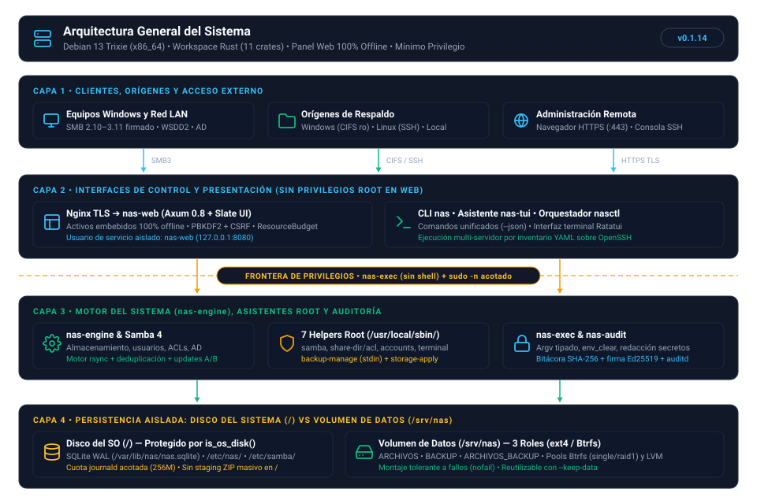
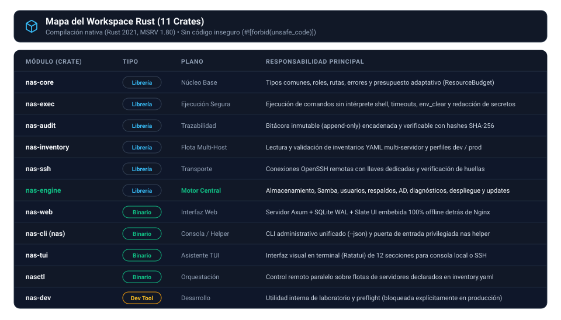
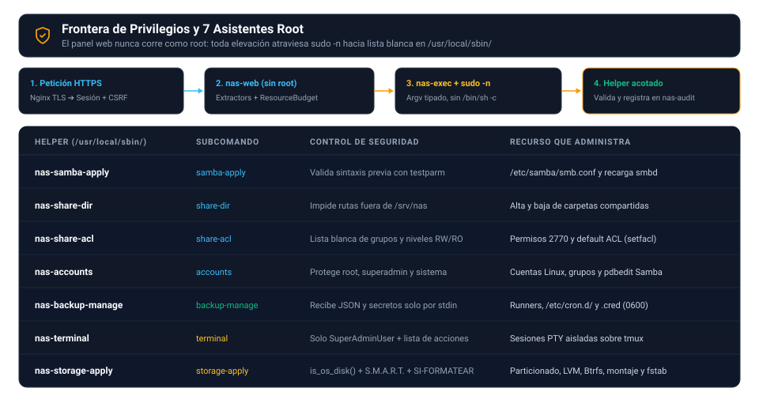
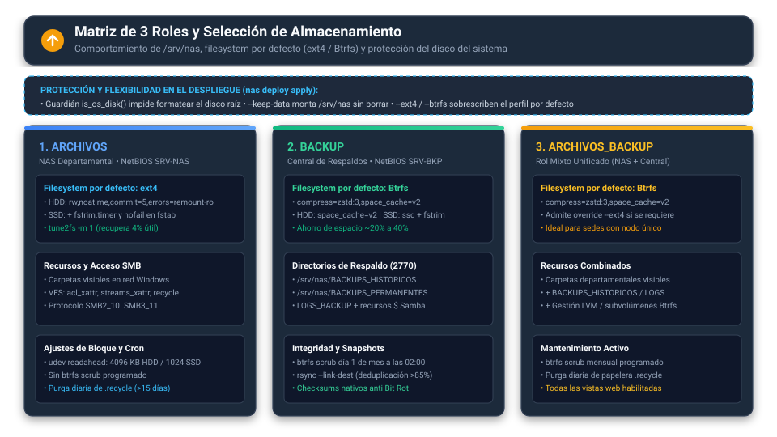
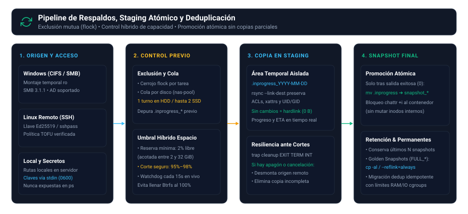

# Arquitectura del Sistema

> [!NOTE]
> Documento de diseño estructural del sistema sobre **Debian 13 Trixie (`x86_64`)** (plataforma Rust `v0.1.12`).
> Los parámetros finos de montaje y comandos de consola viven en **[docs/manual.md](./manual.md)**; el glosario completo del stack en **[docs/tecnologias.md](./tecnologias.md)**; y el modelo de endurecimiento en **[docs/seguridad.md](./seguridad.md)**.

---

## 1. Contexto del Sistema y Restricciones de Diseño

El sistema **NAS (*Network Attached Storage* — Almacenamiento Conectado en Red) & Central de Respaldos** unifica en un único servidor Debian la compartición de archivos para oficinas y la replicación histórica deduplicada de servidores Windows y Linux.

Cuatro restricciones reales del entorno determinan todas las decisiones estructurales:

1. **Operación 100% *offline* (sin dependencia de internet):** toda la interfaz web, iconos y visores ofimáticos se compilan dentro del binario para operar en redes corporativas cerradas sin **CDNs** (*Content Delivery Networks* — Redes de Distribución de Contenidos).
2. **Mínimo privilegio y cero intérprete *shell*:** el servicio web corre con un usuario sin privilegios (`nas-web`) y nunca invoca `/bin/sh -c`; cada acción privilegiada atraviesa argumentos tipados y una lista blanca de asistentes `root`.
3. **Bajo consumo en reposo:** sin intérpretes PHP/Python ni bases de datos externas; binarios nativos Rust y **SQLite** en modo **WAL** (*Write-Ahead Logging* — Registro de Escritura Anticipada).
4. **Resiliencia en hardware de grado consumidor:** aislamiento estricto entre el disco del sistema operativo (`/`) y el volumen de datos (`/srv/nas`), escrituras atómicas en respaldos y límites de memoria/E/S mediante **cgroups** (*Control Groups* — Grupos de Control del kernel Linux).

---

## 2. Vista Modular: Los 11 *Crates* (Módulos Rust)

El código está organizado como un **workspace** (*espacio de trabajo unificado*) de **11 *crates*** (paquetes modulares Rust), con prohibición estricta de código inseguro (`#![forbid(unsafe_code)]`) y compilación nativa.

La arquitectura separa tres planos de responsabilidad con dependencias unidireccionales:

- **Plano de Interfaces (consumidores):** `nas-web` (panel web HTTP), `nas-cli` (binario **`nas`** de **CLI** — *Command-Line Interface* / Interfaz de Línea de Comandos), `nas-tui` (**TUI** — *Text-based User Interface* / Interfaz en Terminal) y `nasctl` (orquestador remoto multi-servidor sobre **YAML** — *YAML Ain't Markup Language* / formato de inventario legible).
- **Plano de Lógica y Seguridad (librerías):** `nas-engine` concentra las reglas de almacenamiento, Samba, usuarios, copias de seguridad y actualizaciones; `nas-exec` ejecuta comandos del sistema de forma segura; `nas-audit` mantiene la cadena criptográfica; `nas-ssh` y `nas-inventory` gestionan la flota remota.
- **Plano Base Compartido:** `nas-core` define los tipos comunes, roles, rutas y el calculador adaptativo `ResourceBudget`.

---

## 3. Frontera de Privilegios y Mapa de Persistencia

### 3.1 Aislamiento de Privilegios (`nas-web` sin `root` ➔ 7 Asistentes)

El servidor HTTP `axum` escucha únicamente en `127.0.0.1:8080` detrás de **Nginx** con **TLS** (*Transport Layer Security* — Seguridad en la Capa de Transporte). Para impedir que una falla web comprometa el sistema completo, las operaciones privilegiadas cruzan una frontera explícita:

1. El navegador autenticado envía una petición validada por cookie `HttpOnly` y token **CSRF** (*Cross-Site Request Forgery* — protección contra falsificación de peticiones).
2. `nas-web` verifica el nivel requerido mediante extractores (`AuthenticatedUser`, `AdminUser`, `SuperAdminUser`) y reserva un permiso en los semáforos de `ResourceBudget`.
3. `nas-exec` lanza `sudo -n` con un arreglo de argumentos tipado (`env_clear()`, sin *shell* y redactando secretos) hacia uno de los **7 *helpers*** (*asistentes privilegiados*) en `/usr/local/sbin/`, que revalidan rutas y reglas antes de ejecutar.

### 3.2 Mapa de Persistencia (Dónde vive cada dato)

Separar dónde se guardan las configuraciones, el estado web y los datos de usuario garantiza que reinstalar o reemplazar el disco del sistema operativo no destruya la información almacenada:

| Ubicación | Qué almacena | Aislamiento y Propósito |
| :--- | :--- | :--- |
| **`/var/lib/nas/`** | Base **SQLite WAL** (`nas.sqlite`: usuarios web, sesiones, auditoría web, límites de intentos) y marcadores de migración | Vive en el volumen de estado; permite respaldo ligero sin demonios externos. |
| **`/etc/nas/` y `/etc/samba/`** | Rol del servidor (`role`), cuenta superadmin, configuración Samba (`smb.conf`), clave pública `Ed25519` (`release.pub`) y credenciales `0600` | Separado de `/srv/nas`; las credenciales nunca se pasan como argumentos visibles en procesos (`ps`). |
| **`/opt/nas_debian/`** | Ranuras **A/B** (*slots* de versión para actualizaciones atómicas con *rollback* / reversión automática) | Permite volver instantáneamente a la versión anterior si falla el *healthcheck* (comprobación de salud). |
| **`/srv/nas/`** | Carpetas compartidas y repositorios históricos de copias de seguridad | Volumen de almacenamiento separado del sistema operativo (`/`). |

---

## 4. Arquitectura de Almacenamiento y Los 3 Roles

El diseño sigue el principio **Pool = Volumen único**: en esta fase la plataforma no implementa **RAID** (*Redundant Array of Independent Disks* — Arreglo Redundante de Discos) por software ni reconstrucción automática; cada punto de montaje administra un volumen dedicado bajo reglas estrictas de seguridad.

- **Aislamiento del disco del sistema (`is_os_disk()`):** tanto el inventario como las operaciones de formato inspeccionan los montajes raíz (`/` y `/boot`) para bloquear cualquier formateo accidental del disco del sistema operativo.
- **Reutilización sin pérdida (`--keep-data`):** al reinstalar Debian sobre un equipo, un volumen `/srv/nas` previo puede volver a montarse conservando intactos los datos y subvolúmenes.
- **Tolerancia a fallos de arranque y hardware consumidor:** los montajes secundarios en `/etc/fstab` incluyen `nofail` (evitando que un fallo de almacenamiento bloquee el arranque y el acceso **SSH** — *Secure Shell*), evitan opciones de desgaste excesivo en flash y exigen pre-chequeo **S.M.A.R.T.** (*Self-Monitoring, Analysis and Reporting Technology* — tecnología de autodiagnóstico de discos).

---

## 5. Flujos Críticos en Ejecución

### 5.1 Pipeline de Respaldos, *Staging* Atómico y Deduplicación

1. **Orígenes soportados:** carpetas compartidas Windows vía **CIFS** (*Common Internet File System* — Sistema de Archivos de Internet Común) montadas en solo lectura, servidores Linux por **SSH** y rutas locales; toda credencial viaja por entrada estándar (**`stdin`**) y se guarda con permisos `0600`.
2. **Control previo y exclusión:** cada tarea adquiere un cerrojo **`flock`** (*file lock* — bloqueo de archivo) y un turno por disco destino (`nas-pool-*`) para no saturar discos mecánicos; antes y cada 15 segundos durante la copia evalúa el umbral híbrido de espacio libre.
3. ***Staging* atómico:** los datos se copian primero en un directorio temporal oculto (`.inprogress_*`) mediante `rsync --link-dest`, creando ***hardlinks*** (*enlaces duros*: apuntadores al mismo archivo físico sin duplicar espacio cuando no hubo cambios). Una trampa de salida limpia desmonta orígenes y borra datos parciales ante apagones.
4. **Promoción atómica y retención:** solo al terminar sin errores se renombra (`mv`) a `snapshot_*`, se sella el contenedor raíz con inmutabilidad (`chattr +i`) y se generan copias base permanentes (*Golden Snapshots* `FULL_*`).

### 5.2 Regulación Adaptativa de Recursos (`ResourceBudget`)

Al iniciar `nas-web` o una migración pesada, `nas-core/src/resources.rs` inspecciona la capacidad real del servidor (respetando límites de contenedores **cgroups**, RAM libre, carga media e indicadores **PSI** — *Pressure Stall Information* / nivel de congestión de CPU, memoria y E/S):

- **Dimensionamiento del servidor HTTP:** ajusta los hilos de **Tokio** (*runtime* asíncrono de Rust), aislando operaciones bloqueantes (SQLite y autenticación) del reactor principal.
- **Semáforos y *Backpressure* (contrapresión):** acota peticiones simultáneas en `system_ops`, `heavy_ops` (compresión ZIP, cálculo de tamaños, auditoría), subidas (`upload_ops`) e inicios de sesión (`auth_ops`), respondiendo HTTP `503` controlado cuando la cola se satura en lugar de agotar la RAM.
- **Límites en segundo plano:** asigna cuotas dinámicas `systemd` (`10-resources.conf` y argumentos `systemd-run` en deduplicación) y pausa reactivamente el *hashing* si detecta presión crítica en disco o memoria.

---

## 6. Decisiones de Arquitectura y Compromisos (*ADRs*)

> [!NOTE]
> **ADRs** (*Architecture Decision Records* — Registros de Decisiones de Arquitectura): resumen el **"por qué"** detrás de los principales compromisos técnicos del sistema.

| Decisión | Alternativa descartada | Por qué se eligió así | Compromiso aceptado |
| :--- | :--- | :--- | :--- |
| **Binarios nativos Rust + SQLite WAL** | Stack PHP-FPM + Python + MySQL/Redis | Cero consumo en reposo, seguridad de memoria sin *garbage collector* y una sola base embebida sin demonios extra. | Toda actualización exige recompilar o distribuir binarios por arquitectura (`x86_64`). |
| **Frontend embebido en el binario** | Archivos estáticos sueltos en `/var/www/` y CDNs | Garantiza operación 100% *offline* y despliegues atómicos en un solo archivo binario. | Cambiar HTML/CSS/JS requiere recompilar y reiniciar `nas-web` (`scripts/deploy_local.sh`). |
| **`nas-web` sin `root` + 7 *helpers* + `nas-exec`** | Ejecutar el panel web directamente como `root` o invocar `/bin/sh -c` | Limita la superficie de ataque ante cualquier fallo web y elimina inyección de comandos de *shell*. | Mantiene dos capas de validación (panel y *helper*) que deben permanecer sincronizadas. |
| **Pool = Volumen único en `/srv/nas`** | Orquestar **RAID** software / ZFS desde la web | Evita falsas promesas de redundancia automática o reconstrucciones riesgosas sin hardware empresarial ni **UPS** (*Uninterruptible Power Supply* — Sistema de Alimentación Ininterrumpida). | La tolerancia física recae en el controlador/infraestructura externa y en respaldos frecuentes. |
| **Enlaces duros (`--link-dest`) + Btrfs** | Formatos propietarios cifrados de backup | Cada *snapshot* es un árbol estándar navegable directamente desde Samba/explorador en emergencias, con ahorro típico >85%. | Exige cuidar permisos POSIX y evitar escaneos recursivos masivos que sobrecarguen los inodos. |

---

## 7. Documentos Relacionados

- [Resumen Ejecutivo y Puerta de Entrada](../README.md)
- [Manual Operativo, Comandos y Matriz FMEA](./manual.md)
- [Stack Tecnológico y Glosario de Siglas](./tecnologias.md)
- [Seguridad y Endurecimiento](./seguridad.md)
- [Laboratorio, CI y Releases](./lab_y_desarrollo.md)
- [Deuda Técnica Activa (`v0.1.12+`)](./deuda_tecnica.md)
