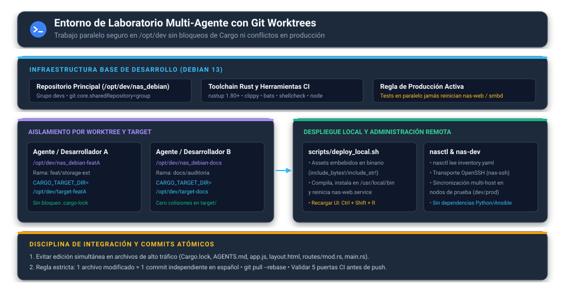
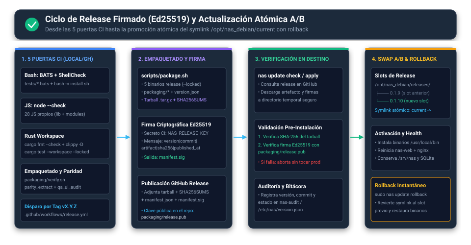

# Laboratorio, Flujo de Desarrollo, CI y Releases

> [!NOTE]
> Documento unificado para desarrolladores, integradores y agentes de IA. Reemplaza `MANUAL_DESARROLLADORES.md`, `Preparar_Laboratorio.md`, `despliegue_rust.md` y `releases.md`, reflejando el flujo activo sobre Debian 13 (`main` `0f7a272`).

---

## 1. Preparación del Entorno de Laboratorio (Debian 13)

El entorno de desarrollo oficial se aloja en `/opt/dev/nas_debian` bajo el grupo compartido `devs`, permitiendo compilar, validar pruebas de integración y desplegar en caliente sobre nodos de prueba sin depender de Python ni herramientas externas.

### 1.1 Requisitos del Host de Desarrollo

- **Toolchain Rust (`rustup`):** versión `1.80` o superior (`rustfmt` y `clippy` instalados).
- **Herramientas de validación local:** `bats` (pruebas Bash), `shellcheck`, `nodejs` (`node --check`), `python3`, `sqlite3`, `pkg-config` y cabeceras de compilación (`build-essential`, `libssl-dev` / `libsqlite3-dev` si no se enlaza bundled).
- **Permisos colaborativos Git:**

```bash
# En el repositorio compartido /opt/dev/nas_debian
git config core.sharedRepository group
sudo chgrp -R devs /opt/dev/nas_debian
sudo chmod -R g+rwX /opt/dev/nas_debian
find /opt/dev/nas_debian -type d -exec sudo chmod g+s {} +
```

---

## 2. Coexistencia Multi-Agente con `git worktree` y `CARGO_TARGET_DIR`

Cuando más de un desarrollador o agente trabaja simultáneamente en el servidor de laboratorio, queda prohibido compilar o editar directamente en el mismo directorio de trabajo.



### 2.1 Creación de Worktree Aislado

```bash
cd /opt/dev/nas_debian
git fetch origin
git worktree add ../nas_debian-mi-tarea -b feat/mi-tarea main

# Usar siempre un CARGO_TARGET_DIR exclusivo para evitar bloqueos .cargo-lock
export CARGO_TARGET_DIR=/opt/dev/target-mi-tarea
cd /opt/dev/nas_debian-mi-tarea
```

### 2.2 Reglas Estrictas de Convivencia y Git (`AGENTS.md`)

1. **Archivos compartidos de alto tráfico prohibidos en paralelo:** no editar simultáneamente `Cargo.lock`, `AGENTS.md`, `README.md`, `crates/nas-web/assets/js/app.js`, `crates/nas-web/templates/layout.html`, `crates/nas-web/src/routes/mod.rs`, `crates/nas-cli/src/commands/mod.rs`, `crates/nas-cli/src/main.rs`, `src/core/deploy.sh`, `src/core/uninstall.sh`, `src/core/updater.sh`.
2. **Commits atómicos 1 archivo = 1 commit:** cada archivo creado, editado o eliminado debe registrarse en su propio commit independiente con mensaje convencional en **español** (`feat:`, `fix:`, `docs:`, `refactor:`, `ci:`).
3. **Servicios de producción intocables en tests paralelos:** ninguna prueba unitaria o de integración debe reiniciar o detener `nas-web`, `smbd` o `nmbd` en el host compartido.
4. **Cero supresiones de lint/CI:** no usar `# shellcheck disable`, flags para omitir advertencias ni debilitar tests para forzar verde.

---

## 3. Despliegue Local Rápido y Orquestación Multi-Host (`nasctl`)

### 3.1 Por qué editar código no cambia la web activa (`deploy_local.sh`)

En `crates/nas-web`, toda la interfaz (`layout.html`, CSS, 28 JS propios, 3 vendor y 52 iconos SVG) está **embebida byte a byte dentro del binario** mediante `include_str!` / `include_bytes!`. Por tanto, editar un archivo en el repositorio **no modifica** el servicio activo hasta recompilar e instalar.

```bash
# Compila e instala nas-web (o todo el workspace con --all) y reinicia el servicio
sudo ./scripts/deploy_local.sh

# Para recompilar todos los binarios (nas, nas-web, nas-tui, nasctl, nas-dev)
sudo ./scripts/deploy_local.sh --all
```

> [!TIP]
> El frontend `/js/app.js` se sirve con `Cache-Control: public, max-age=300`. Tras ejecutar `deploy_local.sh`, recarga el navegador con **`Ctrl + Shift + R`** para invalidar la caché local al instante.

### 3.2 Administración Remota con `nasctl` e `inventory.yaml`

El binario `nasctl` (respaldado por `nas-inventory` y `nas-ssh`) permite operar flotas o pares dev/prod declarados en `/etc/nas/inventory.yaml` sin dependencias Python ni Ansible, validando huellas SSH y llaves dedicadas.

---

## 4. Las 5 Puertas de Validación Local Obligatorias (Pre-Push)

Antes de integrar a `main` o hacer `git push`, debes superar en tu worktree las mismas puertas que exige `.github/workflows/ci.yml`:

```bash
export CARGO_TARGET_DIR=/opt/dev/target-mi-tarea

# 1. Pruebas del motor Bash (BATS)
PATH="$PATH:/usr/sbin" bats --print-output-on-failure tests/*.bats

# 2. Análisis estático Bash
find src scripts packaging -type f -name "*.sh" -print0 | xargs -0 shellcheck -x
bash -n install.sh

# 3. Sintaxis JavaScript (28 módulos propios + 3 vendor)
find crates/nas-web/assets/js -type f -name "*.js" -print0 | xargs -0 -n1 node --check

# 4. Suite Rust completa (formato, clippy estricto y tests con Cargo.lock bloqueado)
cargo fmt --all --check
cargo clippy --workspace --all-targets --locked -- -D warnings
cargo test --workspace --locked

# 5. Empaquetado, paridad UI y auditoría estática
bash packaging/verify.sh
python3 scripts/parity_extract.py --check
python3 scripts/qa_ui_audit.py --static
```

---

## 5. Ciclo de Releases Firmados (`Ed25519`) y Actualización A/B



### 5.1 Empaquetado (`scripts/package.sh`) y Pipeline `.github/workflows/release.yml`

Al crear y subir un tag `vX.Y.Z` (o ejecutar `workflow_dispatch`), GitHub Actions ejecuta `.github/workflows/release.yml`:
1. Compila en modo `--release --locked` los **5 binarios** (`nas`, `nas-web`, `nas-tui`, `nasctl`, `nas-dev`) y valida `packaging/verify.sh`.
2. `scripts/package.sh` construye el tarball `nas_debian-X.Y.Z.tar.gz` (incluyendo `bin/*`, `packaging/*`, `src/*`, `scripts/*`, `install.sh`, `version.json` y metadatos), genera `nas_debian-X.Y.Z.tar.gz.sha256` y emite el manifiesto `nas-X.Y.Z.json`.
3. Mediante el secreto de repositorio `NAS_RELEASE_KEY`, deriva `release.pub` (`cargo run --quiet -p nas-cli -- update pubkey`) y firma con **`Ed25519`** (`update sign`) el manifiesto `nas-X.Y.Z.json` en sitio (incrustando el campo `"signature"` sobre el payload canónico):
   ```text
   version|commit|artifact|sha256|published_at
   ```
4. Verifica localmente con `update verify` y publica en GitHub Releases `nas_debian-X.Y.Z.tar.gz`, `nas_debian-X.Y.Z.tar.gz.sha256`, `nas-X.Y.Z.json` y `release.pub`.

### 5.2 Verificación Criptográfica y Actualización Atómica A/B en Servidor

En los servidores desplegados, la clave pública oficial vive en `/etc/nas/release.pub` o `packaging/release.pub`.

```bash
# Consultar si existe nueva versión oficial
sudo nas update check

# Verificar un artefacto y manifiesto descargados manualmente
nas update verify <nas-X.Y.Z.json> --artifact <nas_debian-X.Y.Z.tar.gz> --pubkey "$(cat packaging/release.pub)"

# Aplicar actualización verificada por SHA-256 + Ed25519 en el siguiente slot A/B
sudo nas update apply --previous <version_actual> --yes
```

- **Slots A/B:** `nas update apply` extrae la nueva versión en `/opt/nas_debian/releases/<version>/`, verifica `SHA-256` y firma `Ed25519`, actualiza de forma atómica el symlink `/opt/nas_debian/current` (`ln -sfn` + `mv -T`), instala los 5 binarios en `/usr/local/bin/` y recarga `nginx` y `nas-web`, preservando intactos `/srv/nas`, `/etc/nas/` y `/var/lib/nas/nas.sqlite`.
- **Rollback automático y recuperación manual:** si cualquier paso o el *healthcheck* (`https://127.0.0.1/login`) falla durante `nas update apply --previous <version_actual>`, el plan ejecuta el rollback automático hacia `/opt/nas_debian/releases/<version_actual>/`; si fuese necesario revertir manualmente después de terminar, basta con reenlazar `/opt/nas_debian/current` al slot previo (`ln -sfn` + `mv -T`), reinstalar `/opt/nas_debian/current/bin/*` en `/usr/local/bin/` y reiniciar `nas-web` + `nginx`.
