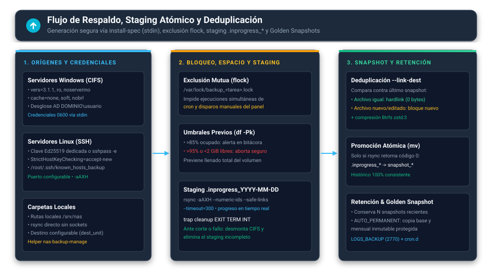

# Operación Diaria y Mantenimiento Preventivo • NAS Debian 13

Este manual explica cómo operar el servidor en el día a día, cómo gestionar recursos y copias de seguridad, cómo restaurar información perdida y qué tareas preventivas realizar para asegurar la máxima vida útil y estabilidad del sistema.

---

## 1. Guía Rápida de Comandos CLI `nas`

El servidor cuenta con el comando global `nas` disponible en cualquier terminal:

| Comando | Acción | Cuándo utilizarlo |
| :--- | :--- | :--- |
| `sudo nas-tui` | Panel visual de monitoreo (ratatui) | Para consultar el dashboard, métricas de hardware, estado de servicios y bitácora desde la consola sin interfaz gráfica. |
| `sudo nas status` | Diagnóstico de salud en vivo | Para revisar de un vistazo métricas de hardware, IP, servicios de red y almacenamiento. |
| `sudo nas --json status` | Métricas y salud en formato JSON | Para integrarlo en scripts de monitoreo externos o agentes. |
| `sudo nas storage list` | Inventario de almacenamiento | Para listar los dispositivos de bloque y su estado (`SO · protegido`, `En uso` o `Disponible`). |
| `sudo nas users list` | Inventario de usuarios locales | Para consultar las cuentas de sistema y grupos departamentales. |
| `sudo nas backup list` | Listado de tareas de respaldo | Para consultar las tareas programadas y su configuración. |
| `sudo nas backup run <id>` | Ejecución manual de respaldo | Para disparar una copia de seguridad específica desde consola. |
| `sudo nas deploy plan [args]` | Planificación de despliegue | Simula el particionado, formateo y aprovisionamiento del servidor. |
| `sudo nas deploy apply [args] --password-stdin` | Despliegue del servidor | Aplica los artefactos (rol, sysctl, udev, logrotate, auditd, scrub, superadmin y smb.conf) y sincroniza la contraseña del administrador con el panel. |
| `sudo nas update verify <manifiesto> --pubkey <hex>` | Verificación de una release | Valida SHA-256 y firma Ed25519 del manifiesto. |
| `sudo nas audit verify` | Verifica la cadena de auditoría | Audita criptográficamente la bitácora de eventos del sistema. |
| `sudo nas uninstall --yes [--scope os]` | Desinstala la plataforma | Conserva `/srv/nas`; `--scope os` retira además sysctl, udev, logrotate y auditd; `--purge` borra `/var/lib/nas` y `/etc/nas`. |
| `sudo nas uninstall` | Muestra el plan de desinstalación | Revisión previa de los pasos sin ejecutar cambios. |
| `sudo nas update sign <json> --key <archivo-hex>` | Firma un manifiesto de release (Ed25519) | Publicación de versiones verificables; la clave es un archivo hexadecimal. |
| `sudo nas update pubkey --key <archivo-hex>` | Deriva la clave pública de la privada | Configurar `--pubkey` en verify/apply. |

> El panel web (`/dashboard`) ofrece las mismas 14 vistas y la misma interfaz
> Slate UI que el panel original, servida desde `nas-web.service`.

---

## 2. Gestión de Almacenamiento y Discos

### 2.1 Puntos de Montaje y Ubicación de Datos
Todo el almacenamiento administrado por el sistema reside en `/srv/nas`:
- `/srv/nas/<RECURSO>`: Carpetas compartidas para los usuarios de red.
- `/srv/nas/BACKUPS_HISTORICOS/<tarea>/`: Repositorio de copias de seguridad deduplicadas.
- `/srv/nas/LOGS_BACKUP/`: Bitácoras detalladas de cada tarea de respaldo.
- `/srv/nas/.trash/`: Papelera de reciclaje web con metadatos de restauración.

### 2.2 Despliegue con Formateo vs Conservar Datos (`--keep-data`)
- **Si el disco es nuevo o puede sobrescribirse:** Utiliza el aprovisionamiento desde el Panel Web (pestaña **Almacenamiento** → **Gestión de disco**) o el comando `sudo nas deploy apply ...`. El sistema detecta automáticamente si es HDD o SSD y aplica el sistema de archivos óptimo (`ext4` para NAS o `Btrfs` para copias de seguridad).
- **Si el disco ya tiene datos previos (Reutilización segura):** Selecciona la opción de reutilización o agrega `--keep-data` en la consola. El sistema detectará la partición válida, montará el volumen en `/srv/nas` y optimizará los parámetros de lectura y escritura sin alterar ningún archivo previo.

### 2.3 Gestión de Discos desde el Panel Web
La pestaña **Almacenamiento** lista los dispositivos de bloque con su estado (`SO · protegido`, `En uso` o `Disponible`) y ofrece el botón **Gestión de disco** para:
- **Formatear y montar en `/srv/nas`** en `ext4` o `Btrfs` (con las optimizaciones según tipo de disco).
- **Crear un volumen LVM** (PV → VG → LV) y montarlo en `/srv/nas`.
- **Crear un subvolumen Btrfs**.

Toda operación destructiva exige escribir textualmente `SI-FORMATEAR`. El disco del sistema operativo queda siempre protegido (`isOsDisk`) y nunca se lista como candidato; los discos en uso (montados, PV de LVM o miembros de RAID) también se excluyen. Si el disco destino (o una de sus particiones, como `/srv/nas`) está montado, el panel **ofrece desmontarlo** antes de continuar en lugar de rechazar la operación.

### 2.4 Monitoreo de Capacidad
Para verificar el espacio en cualquier momento:
```bash
df -h /srv/nas
```
El motor de copias de seguridad supervisa el espacio automáticamente:
- **Al superar el 85% de ocupación:** Registra una advertencia preventiva en la bitácora.
- **Si quedan menos de 2 GB libres o la ocupación supera el 95%:** Cancela la tarea de respaldo antes de iniciar para impedir la corrupción del filesystem por agotamiento de espacio.

---

## 3. Gestión de Recursos Compartidos y Clientes Samba

### 3.1 Crear un Recurso Compartido
Se administra desde el Panel Web (pestaña **Redes compartidas**) o mediante los helpers dedicados `/usr/local/sbin/nas-samba-apply` y `/usr/local/sbin/nas-share-acl`:
1. Asigna un nombre al recurso (ej. `CONTABILIDAD` o `BACKUPS_SISTEMAS$`). Si termina con el signo `$`, quedará oculto en la red.
2. Selecciona el esquema de permisos:
   - **Esquema 1 (Lectura y Escritura por Grupo):** Todos los grupos asignados pueden leer y escribir.
   - **Esquema 2 (Solo Lectura General + Escritura Exclusiva):** Todos los grupos leen, pero solo uno tiene permisos de modificación (aplica `default ACL` para herencia automática).
   - **Esquema 3 (Solo Lectura Estricta):** Nadie puede modificar datos en el recurso por red.
   - **Esquema 4 (Público / Invitados):** Acceso libre sin usuario ni contraseña.

### 3.2 Conectar Equipos Clientes desde Windows
1. Abre el Explorador de Archivos de Windows.
2. En la barra de direcciones escribe: `\\<IP_DEL_NAS>\<RECURSO>` (ejemplo: `\\10.10.1.2\CONTABILIDAD`).
3. Introduce el usuario y contraseña creados en el NAS.
4. Para mayor comodidad, haz clic derecho sobre la carpeta y elige **"Conectar a unidad de red..."** para asignarle una letra (ej. `Z:`).

---

## 4. Motor de Copias de Seguridad y Deduplicación



### 4.1 Programar una Tarea de Respaldo
Desde el Panel Web (**Respaldos**) o mediante `sudo nas backup run <id>` para ejecución puntual:
- **Origen Windows:** Introduce la IP, el recurso remoto y las credenciales. Si el host pertenece a un dominio corporativo, usa el formato `DOMINIO\usuario`. Las credenciales quedan protegidas en `/etc/backup-credentials/<tarea>.cred` con permisos `0600`.
- **Origen Linux:** Introduce la IP del servidor remoto, el puerto SSH (22 por defecto), la ruta absoluta a respaldar y las credenciales. La huella digital del servidor se registra de forma aislada en `/root/.ssh/known_hosts_backup`.
- **Origen Local:** Selecciona una carpeta dentro del propio servidor.

### 4.2 Procedimiento de Restauración de Archivos
Dado que los backups se basan en enlaces duros (*hardlinks*), cada snapshot es una copia completa e independiente en el tiempo:
1. Accede a la carpeta de snapshots de la tarea:
   ```bash
   cd /srv/nas/BACKUPS_HISTORICOS/<tarea>/
   ls -la
   ```
2. Identifica la fecha requerida (ej. `snapshot_2026-10-01_220000`).
3. Copia el archivo o directorio dañado hacia el recurso de producción:
   ```bash
   # Restaurar un archivo específico de Excel:
   cp -a snapshot_2026-10-01_220000/Balances/Octubre.xlsx /srv/nas/CONTABILIDAD/Balances/

   # Restaurar una carpeta completa:
   cp -a snapshot_2026-10-01_220000/Proyectos/ /srv/nas/DISENO/
   ```

### 4.3 Cancelar una Tarea en Ejecución (Aborto Seguro)
Si una copia de seguridad está tardando demasiado o satura la red:
- **Desde la interfaz web:** En la sección **Respaldos**, pulsa el botón **"Abortar"** en la tarea activa.
- **Desde la terminal:** Cancela el proceso activo o libera el cerrojo en `/var/lock/backup_<tarea>.lock`.
El sistema detendrá el proceso de `rsync`, liberará el cerrojo de `flock`, desmontará el recurso remoto de forma limpia y eliminará el directorio provisional `.inprogress_*`, garantizando que el histórico no guarde copias corruptas.

---

## 5. Explorador Web, Edición en Vivo y Papelera

- **Subir archivos grandes:** Arrastra archivos desde tu explorador de Windows directamente a la ventana del navegador (admite transferencias de hasta 50 GB por archivo con barra de progreso).
- **Descargar carpetas en ZIP:** Haz clic en el botón de descarga junto a cualquier carpeta para recibir un archivo comprimido generado en el instante.
- **Editar archivos de configuración:** Haz clic en cualquier archivo de texto para abrir el visor. Pulsa **"Editar"**, haz las modificaciones directamente en el editor con numeración de líneas y haz clic en **"Guardar"**.
- **Papelera de reciclaje:**
  - Los archivos eliminados en la interfaz web no se borran permanentemente de inmediato; se mueven a la papelera registrando su ruta de origen.
  - El botón con el icono de papelera en la barra superior muestra el número de archivos resguardados.
  - Al abrir la papelera puedes **"Restaurar"** un archivo a su carpeta exacta de procedencia o **"Vaciar papelera"** para recuperar espacio en disco.

---

## 6. Lista de Verificación de Mantenimiento Periódico

Para asegurar una operación ininterrumpida, se recomienda seguir este calendario:

### Tareas Semanales
- **Revisar estado de salud general:**
  ```bash
  sudo nas status
  ```
- **Inspeccionar bitácoras de respaldos recientes:**
  Revisa si hay advertencias de espacio o errores en `/srv/nas/LOGS_BACKUP/`.

### Tareas Mensuales
- **Verificar el estado de Btrfs Scrub (solo rol `BACKUP`):**
  La tarea corre automáticamente el día 1 de cada mes a las 02:00. Comprueba su resultado con:
  ```bash
  btrfs scrub status /srv/nas
  ```
  Debe indicar `0 errors`. Si reporta errores corregibles, Btrfs los repara en caliente.
- **Comprobar el recorte de bloques en SSD (`fstrim`):**
  ```bash
  systemctl status fstrim.timer
  ```
- **Auditoría de rotación de bitácoras:**
  Comprueba que `/etc/logrotate.d/nas-backups` mantenga comprimidos los registros antiguos.

### Tareas Trimestrales
- **Actualizaciones del sistema operativo base Debian:**
  ```bash
  sudo apt update && sudo apt upgrade -y
  ```
- **Actualizaciones del gestor NAS:**
  ```bash
  sudo nas update
  ```

---

## 7. Preparación y Despliegue Manual Paso a Paso

Si por políticas corporativas de auditoría o entornos aislados prefieres preparar el servidor manualmente en lugar de usar el instalador remoto one-liner, sigue esta guía:

### Fase 1: Bootstrap como `root` (Pasos 1 al 7)

1. Inicia sesión como superusuario:
   ```bash
   su -
   ```

2. Configura los repositorios oficiales de Debian 13 en formato deb822 (`/etc/apt/sources.list.d/debian.sources`) y actualiza:
   ```bash
   cat << 'SOURCES' > /etc/apt/sources.list.d/debian.sources
   Types: deb deb-src
   URIs: http://deb.debian.org/debian
   Suites: trixie trixie-updates
   Components: main contrib non-free non-free-firmware

   Types: deb deb-src
   URIs: http://security.debian.org/debian-security
   Suites: trixie-security
   Components: main contrib non-free non-free-firmware
   SOURCES

   : > /etc/apt/sources.list
   apt update && apt upgrade -y
   ```

3. Instala los paquetes base de administración y seguridad:
   ```bash
   apt install -y curl wget ca-certificates htop ufw sudo fail2ban unattended-upgrades git build-essential pkg-config
   ```

4. Asegura la cuenta de administración y concede privilegios `sudo`:
   ```bash
   ADMIN_USER="$(awk -F: '$3 >= 1000 && $3 < 60000 && $1 != "nobody" {print $1; exit}' /etc/passwd)"
   ADMIN_USER="${ADMIN_USER:-nas}"
   id "$ADMIN_USER" &>/dev/null || adduser --disabled-password --gecos "" "$ADMIN_USER"
   usermod -aG sudo "$ADMIN_USER"
   echo "$ADMIN_USER ALL=(ALL:ALL) ALL" > "/etc/sudoers.d/90-admin"
   chmod 0440 "/etc/sudoers.d/90-admin"
   echo "Administrador listo: $ADMIN_USER"
   ```

5. Cierra la sesión de `root`:
   ```bash
   exit
   ```

### Fase 2: Endurecimiento como Administrador con `sudo` (Pasos 8 al 13)

1. Desactiva el acceso directo de `root` por SSH:
   ```bash
   sudo sed -i 's/^#*PermitRootLogin.*/PermitRootLogin no/' /etc/ssh/sshd_config
   grep -rl "PermitRootLogin" /etc/ssh/sshd_config.d/ 2>/dev/null | xargs -r sudo sed -i 's/^#*PermitRootLogin.*/PermitRootLogin no/'
   sudo systemctl restart ssh || sudo systemctl restart sshd
   ```

2. Configura el cortafuegos UFW con política restrictiva:
   ```bash
   sudo ufw default deny incoming
   sudo ufw default allow outgoing
   sudo ufw allow 22/tcp comment 'SSH'
   sudo ufw allow 80/tcp comment 'Panel Web HTTP'
   sudo ufw allow 443/tcp comment 'Panel Web HTTPS'
   sudo ufw allow 137,138/udp comment 'Samba NetBIOS'
   sudo ufw allow 139,445/tcp comment 'Samba SMB'
   sudo ufw allow 3702/udp comment 'WSDD2 Discovery UDP'
   sudo ufw allow 3702/tcp comment 'WSDD2 Discovery TCP'
   sudo ufw allow 5355/udp comment 'WSDD2 LLMNR UDP'
   sudo ufw allow 5355/tcp comment 'WSDD2 LLMNR TCP'
   sudo ufw allow 5357/tcp comment 'WSDD2 HTTP'
   sudo ufw --force enable
   ```

3. Bloquea suspensión e hibernación para garantizar operación 24/7:
   ```bash
   sudo systemctl mask sleep.target suspend.target hibernate.target hybrid-sleep.target
   sudo mkdir -p /etc/systemd/logind.conf.d
   printf '[Login]\nHandleSuspendKey=ignore\nHandleHibernateKey=ignore\nHandleLidSwitch=ignore\n' | sudo tee /etc/systemd/logind.conf.d/99-nas.conf >/dev/null
   sudo systemctl restart systemd-logind
   ```

4. Habilita fail2ban:
   ```bash
   sudo cp /etc/fail2ban/jail.conf /etc/fail2ban/jail.local
   sudo systemctl enable --now fail2ban
   ```

### Fase 3: Despliegue del Software NAS

Una vez preparado el servidor, usa el instalador oficial (compila el workspace Rust,
instala binarios, servicio y Nginx):

```bash
sudo git clone https://github.com/ftole/nas_debian.git /opt/nas_debian
cd /opt/nas_debian
sudo bash install.sh

# Verificación
sudo nas status
systemctl is-active nas-web
curl -fsS http://127.0.0.1:8080/healthz
```

El aprovisionamiento del sistema operativo (particionado, formateo, sysctl, auditd,
AIDE) sigue a cargo de `src/core/deploy.sh` hasta completar la ola B.

