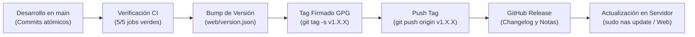

# Manual de Publicación y Gestión de Releases • NAS Debian 13

Este manual documenta el procedimiento estándar, seguro y repetible para preparar, firmar criptográficamente con GPG y publicar tanto el **primer release (versión inicial o beta)** como los **segundos y posteriores releases (actualizaciones, parches y mejoras continuas)** del Servidor NAS y Central de Respaldos.

---

## 1. Fundamentos y Estándar de Versionado

El proyecto se rige estrictamente por **Versionado Semántico (SemVer 2.0.0)** y **Cadenas de Confianza Criptográfica**:

```text
       v [MAJOR] . [MINOR] . [PATCH] - [PRE-RELEASE]
            │         │         │              │
            │         │         │              └──> ej. -beta.1, -rc.1 (versiones de prueba)
            │         │         └─────────────────> Corrección de errores y seguridad (retrocompatible)
            │         └───────────────────────────> Nuevas características y módulos (retrocompatible)
            └─────────────────────────────────────> Cambios mayores o incompatibles con versiones previas
```

### Reglas de Nomenclatura del Proyecto
- **Versiones Preliminares (Beta / RC):** `v1.0.0-beta.1`, `v1.0.0-beta.2`, `v1.0.0-rc.1`.
- **Versión de Producción General (GA):** `v1.0.0`.
- **Actualizaciones de Mantenimiento:** `v1.0.1`, `v1.0.2`.
- **Nuevas Características Retrocompatibles:** `v1.1.0`, `v1.2.0`.

> [!IMPORTANT]
> Todos los releases del proyecto deben estar respaldados por un **Tag de Git firmado con clave PGP/GPG**. El script de actualización remota del servidor ([`src/core/updater.sh`](../src/core/updater.sh)) valida la firma con `git tag -v` antes de aplicar cambios en producción, blindando el servidor contra ataques de intermediario (*Man-in-the-Middle*) o suplantación en la cadena de suministro.

---

## 2. Fase 0: Configuración Única del Entorno de Firmas GPG

Este procedimiento se realiza una única vez en la estación de trabajo del mantenedor/desarrollador.

### 2.1 Comprobar o Generar Clave GPG

Abre PowerShell o Git Bash en tu equipo de desarrollo:

1. **Verificar si ya cuentas con claves GPG:**
   ```powershell
   gpg --list-secret-keys --keyid-format=long
   ```
2. **Generar una nueva clave si no existe:**
   ```powershell
   gpg --full-generate-key
   ```
   * **Tipo de clave:** `(1) RSA and RSA` (o presiona Enter).
   * **Longitud en bits:** `4096`.
   * **Periodo de validez:** `0` (la clave no caduca, o el tiempo corporativo deseado).
   * **Nombre y Apellidos:** El mismo nombre configurado en Git (`git config user.name`).
   * **Dirección de correo electrónico:** El mismo correo asociado a tu cuenta de GitHub (`git config user.email`).
   * **Frase de contraseña (passphrase):** Ingresa una contraseña robusta. Esta frase se te solicitará cada vez que firmes un release.

3. **Identificar el Key ID de tu clave:**
   Ejecuta nuevamente:
   ```powershell
   gpg --list-secret-keys --keyid-format=long
   ```
   Ubica la línea que inicia con `sec rsa4096/`:
   ```text
   sec   rsa4096/3AA5C34371567BD2 2026-10-19 [SC]
   ```
   En este ejemplo, el **Key ID** es `3AA5C34371567BD2`.

4. **Configurar Git para firmar con tu clave:**
   ```powershell
   git config --global user.signingkey 3AA5C34371567BD2
   git config --global gpg.program gpg
   ```

---

### 2.2 Registrar la Clave Pública en GitHub

Para que GitHub reconozca tus releases con la insignia verde **"Verified"**:

1. **Exportar la clave pública en formato ASCII:**
   ```powershell
   gpg --armor --export 3AA5C34371567BD2
   ```
2. **Copiar el bloque de texto completo**, incluyendo:
   ```text
   -----BEGIN PGP PUBLIC KEY BLOCK-----
   ... (contenido de la clave) ...
   -----END PGP PUBLIC KEY BLOCK-----
   ```
3. **Guardar en GitHub:**
   - Ve a [GitHub Settings → SSH and GPG keys](https://github.com/settings/keys).
   - Haz clic en **New GPG key**.
   - Asigna un título descriptivo (ej. `Clave Firma Releases NAS`) y pega el bloque.
   - Haz clic en **Add GPG key**.

---

### 2.3 Importar la Clave Pública en el Servidor Debian

Para que el script [`updater.sh`](../src/core/updater.sh) y el comando `sudo nas update` en el servidor Debian verifiquen los releases:

1. **Exportar la clave pública a un archivo:**
   ```powershell
   gpg --armor --export 3AA5C34371567BD2 > clave_autor_nas.asc
   ```
2. **Transferir el archivo al servidor:**
   ```powershell
   scp clave_autor_nas.asc sistemas@10.10.1.222:/tmp/
   ```
3. **Importar en el keyring de root en Debian:**
   ```bash
   sudo gpg --import /tmp/clave_autor_nas.asc
   sudo rm /tmp/clave_autor_nas.asc
   ```
4. **Verificar que root reconoce la clave:**
   ```bash
   sudo gpg --list-keys
   ```

---

## 3. Guía Paso a Paso: Publicación del PRIMER Release (`v1.0.0-beta.1`)

El primer release marca el hito donde la arquitectura, seguridad, servicios y paneles han completado la fase de estabilización.

### Paso 1: Checklist Pre-vuelo de Calidad
Antes de congelar la versión, verifica que todas las suites de validación pasen al 100%:

```powershell
# 1. Pruebas unitarias backend web y controladores
php tests/test_web.php

# 2. Pruebas de integración remota (pytest)
pytest tests/ -q

# 3. Pruebas de estilo y buenas prácticas Python
flake8 tests/

# 4. Asegurar árbol de trabajo limpio y sincronizado con main
git checkout main
git pull origin main
git status
```

> [!WARNING]
> No crees releases con cambios sin confirmar (`working tree dirty`) o pruebas fallidas en GitHub Actions CI.

---

### Paso 2: Actualizar Metadatos de Versión en el Repositorio
Actualiza el archivo de versión que lee el panel web ([`web/version.json`](../web/version.json)):

```json
{
  "version": "1.0.0-beta.1",
  "build": 1,
  "release_date": "2026-10-19",
  "channel": "beta",
  "notes": "Primer Release Beta: Servidor NAS Departamental, Central de Respaldos Btrfs/CIFS/SSH y Panel Web MVC"
}
```

Confirma el cambio de forma atómica:
```powershell
git add web/version.json
git commit -m "chore: actualizar metadatos para release v1.0.0-beta.1"
git push origin main
```

---

### Paso 3: Crear el Tag Criptográficamente Firmado
Ejecuta `git tag` con la bandera **`-s`** (*Signed*):

```powershell
git tag -s v1.0.0-beta.1 -m "Release v1.0.0-beta.1: Servidor NAS y Central de Respaldos Multiplataforma Debian 13"
```
*(El sistema te solicitará la contraseña de tu clave GPG).*

---

### Paso 4: Verificar la Firma Localmente
Comprueba que el tag contiene una firma válida antes de enviarlo:

```powershell
git tag -v v1.0.0-beta.1
```
Debe devolver:
```text
gpg: Signature made ... using RSA key 3AA5C34371567BD2
gpg: Good signature from "Tu Nombre <tu-correo@dominio.com>" [ultimate]
```

---

### Paso 5: Publicar el Tag a GitHub
Envía el tag firmado al repositorio remoto:

```powershell
git push origin v1.0.0-beta.1
```

---

### Paso 6: Redactar y Publicar el Release en GitHub
1. Ingresa a tu repositorio en GitHub y navega a **Releases** → **Draft a new release**.
2. **Choose a tag:** Selecciona `v1.0.0-beta.1`.
3. **Target:** `main`.
4. **Release title:** `v1.0.0-beta.1 • Servidor NAS & Central de Respaldos (Beta Inicial)`.
5. **Descripción:** Incluye el resumen ejecutivo, novedades y changelog estructurado:
   ```markdown
   ## 🚀 Novedades del Release v1.0.0-beta.1
   
   - **Tres Roles Especializados:** `ARCHIVOS` (ext4 optimizado), `BACKUP` (Btrfs con compresión Zstandard) e híbrido `ARCHIVOS_BACKUP`.
   - **Central de Respaldos:** Replicación CIFS 3.1.1, SSH y Local con deduplicación por enlaces duros (>85% ahorro) y staging atómico `.inprogress_*`.
   - **Explorador de Archivos Web:** Visualización de tamaños de carpetas con deduplicación de hardlinks, drag-and-drop y descargas ZIP sin límite con notificación de progreso.
   - **Seguridad Endurecida:** Control de acceso granular (ACLs POSIX), rate-limiting en SQLite WAL, auditoría kernel auditd y protección de disco raíz del sistema operativo.
   - **Terminal PTY Real:** Sesiones interactivas tmux aisladas por usuario.
   
   ### 📦 Instalación Limpia en Servidor Debian 13:
   ```bash
   curl -sSL https://raw.githubusercontent.com/ftole/nas_debian/v1.0.0-beta.1/install.sh | sudo bash
   ```
   ```
6. **Casilla de Pre-release:** Marca la casilla **"Set as a pre-release"** (por ser versión Beta).
7. Haz clic en **Publish release**.

---

### Paso 7: Validar la Actualización en el Servidor Debian
Conéctate por SSH al servidor de pruebas y comprueba que reconoce la firma:

```bash
# Ejecutar actualización oficial
sudo nas update
```
El script mostrará:
```text
[*] Comprobando firma criptográfica del tag v1.0.0-beta.1...
[✓] Firma GPG válida de Tu Nombre <tu-correo@dominio.com>.
[*] Aplicando actualización...
[✓] Servidor NAS actualizado exitosamente a v1.0.0-beta.1.
```

---

## 4. Guía Paso a Paso: Publicación de SEGUNDOS y Posteriores Releases

Cuando se desarrollan nuevas funciones, parches de seguridad o correcciones de bugs, se utiliza este ciclo ágil de entrega continua:



### Paso 1: Determinar el Tipo de Incremento SemVer
Según los cambios acumulados desde el release anterior:
- **Correcciones o Parches:** Incrementa el tercer dígito (ej. de `v1.0.0` a `v1.0.1`).
- **Nuevas Funcionalidades Retrocompatibles:** Incrementa el segundo dígito (ej. de `v1.0.1` a `v1.1.0`).
- **Segunda Beta:** Incrementa el sufijo (ej. de `v1.0.0-beta.1` a `v1.0.0-beta.2`).
- **Paso de Beta a Release Oficial Estable:** Retira el sufijo beta (ej. de `v1.0.0-rc.1` a `v1.0.0`).

---

### Paso 2: Generar Changelog Comparativo
Inspecciona los commits atómicos incorporados desde el último tag:

```powershell
git log v1.0.0-beta.1..HEAD --oneline
```

Clasifica los cambios en:
- `feat:` Nuevas características.
- `fix:` Corrección de errores.
- `security:` Mitigaciones de seguridad.
- `perf:` Optimizaciones de rendimiento.

---

### Paso 3: Actualizar `web/version.json`
Actualiza el número de versión y fecha:

```json
{
  "version": "1.0.0-beta.2",
  "build": 2,
  "release_date": "2026-10-25",
  "channel": "beta",
  "notes": "Optimizaciones de compresión ZIP, cálculo reactivo de tamaños y mejoras de UX en respaldos"
}
```

Confirma y envía a `main`:
```powershell
git add web/version.json
git commit -m "chore: actualizar metadatos para release v1.0.0-beta.2"
git push origin main
```

---

### Paso 4: Crear y Enviar el Nuevo Tag Firmado
```powershell
# 1. Crear tag firmado con mensaje descriptivo
git tag -s v1.0.0-beta.2 -m "Release v1.0.0-beta.2: Mejoras de rendimiento y estabilidad"

# 2. Validar firma
git tag -v v1.0.0-beta.2

# 3. Publicar tag
git push origin v1.0.0-beta.2
```

---

### Paso 5: Publicar el Release en GitHub
1. Ve a **Releases** → **Draft a new release**.
2. Selecciona el nuevo tag `v1.0.0-beta.2`.
3. Haz clic en **Generate release notes** (GitHub agrupará automáticamente los PRs y commits) o pega tu changelog clasificado.
4. Si es versión final de producción, desmarca la casilla "Set as a pre-release" y marca **"Set as the latest release"**.
5. Publica el Release.

---

### Paso 6: Actualización desde el Panel Web o Consola
Los administradores pueden actualizar sus servidores de dos formas equivalentes:

1. **Desde la Consola del Servidor:**
   ```bash
   sudo nas update
   ```
2. **Desde el Panel Web Administrativo:**
   - Navega a la pestaña **Actualizaciones**.
   - Haz clic en **Buscar actualizaciones**.
   - El panel detectará el nuevo release firmado y habilitará el botón **Actualizar ahora**.
   - Al confirmar, el helper [`nas-web-updater`](../src/core/deploy.sh) ejecutará la actualización con verificación de firma y recarga limpia de demonios.

---

## 5. Matriz de Solución de Problemas (Troubleshooting GPG & Releases)

| Problema / Error | Causa Raíz | Solución Inmediata |
| :--- | :--- | :--- |
| `gpg: signing failed: secret key not available` | Git no encuentra el binario GPG o la clave no está en el keyring local. | Verifica con `gpg --list-secret-keys` y asegura la ruta con `git config --global gpg.program gpg`. En Windows, instala *Gpg4win* si no cuentas con el agente `pinentry`. |
| `error: gpg failed to sign the data` | La sesión de terminal no puede abrir la ventana para pedir la contraseña (*pinentry*). | En Git Bash/PowerShell define: `export GPG_TTY=$(tty)` o reinicia el agente GPG con `gpgconf --kill gpg-agent`. |
| `[!] No se encontró una versión firmada válida` al ejecutar `nas update` | El tag fue creado sin la bandera `-s` (no está firmado) o la clave pública del autor no ha sido importada en root en Debian. | 1. Importa la clave en Debian con `sudo gpg --import clave_autor.asc`.<br>2. Para entornos de desarrollo o pruebas sin clave GPG, autoriza la actualización temporal con: `sudo NAS_ALLOW_UNSIGNED_UPDATES=true nas update`. |
| El release no muestra la insignia verde **Verified** en GitHub | El correo configurado en la clave GPG no coincide con ningún correo verificado en tu cuenta de GitHub. | Agrega el correo de la clave en **GitHub Settings → Emails** o genera una clave que use tu correo verificado. |
| El servidor actualizó pero el navegador sigue viendo la versión anterior | La caché del navegador o el caché de código de operación (OPcache) de PHP-FPM conserva archivos antiguos. | En Debian recarga PHP-FPM con `sudo systemctl reload php*-fpm` y realiza una recarga forzada en el navegador (`Ctrl + F5`). |

---

## 6. Checklist de Seguridad para Releases de Producción

Antes de marcar un release como versión final de producción (`v1.0.0` o superior):
- [ ] Todas las pruebas de inyección de fallos pasan (`tests/failure_*.bats`).
- [ ] Los permisos de directorios sensibles están confinados (`/etc/backup-credentials` en `0600 root:root`, `/srv/nas/.trash` y `/srv/nas/.tmp_zip` en `2770 root:grp_samba`).
- [ ] No existen credenciales, contraseñas ni archivos `.env` versionados en Git.
- [ ] El script [`updater.sh`](../src/core/updater.sh) preserva intactas las carpetas compartidas y las bases de datos de auditoría (`nas.sqlite`).
- [ ] La firma del tag es verificada exitosamente en una máquina limpia con `git tag -v`.
