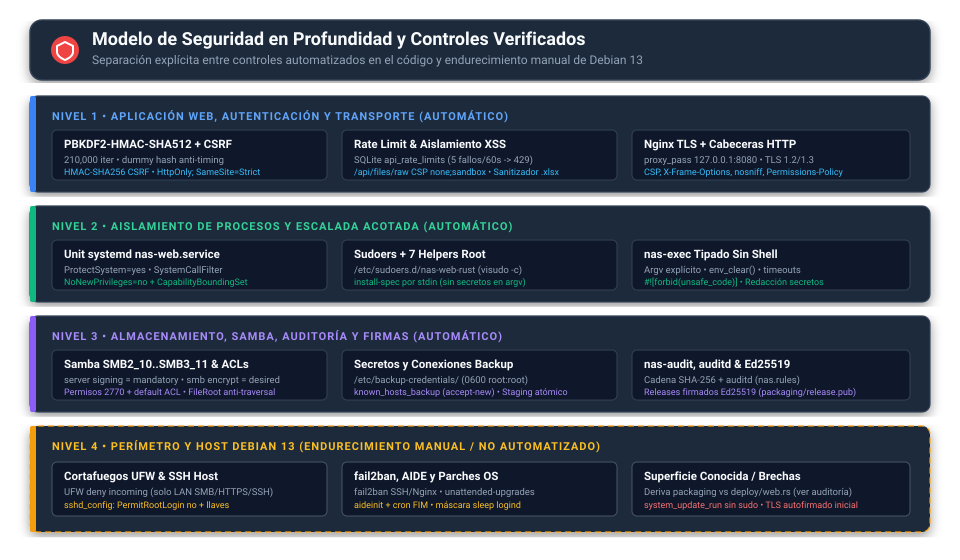
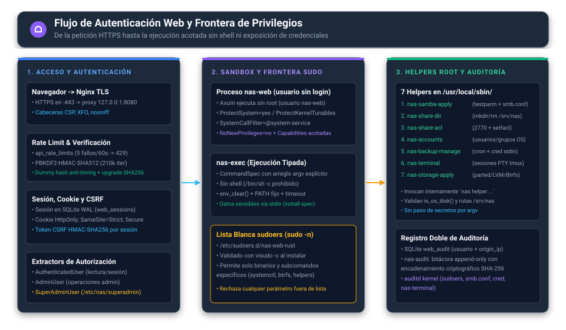

# Seguridad y Endurecimiento del Sistema

> [!IMPORTANT]
> Este documento distingue de forma estricta entre **(1) controles automatizados ya implementados en el código y empaquetado**, **(2) endurecimiento manual obligatorio sobre Debian 13** que el administrador debe aplicar en el servidor, y **(3) brechas abiertas verificadas** sobre `main` (`0f7a272`).

---

## 1. Controles Automatizados en Código y Empaquetado

Los siguientes controles se aplican automáticamente mediante `install.sh`, `packaging/install.sh` y el propio código fuente Rust de `nas-web`, `nas-exec`, `nas-engine` y `nas-audit`.

### 1.1 Autenticación Web, Sesiones y Protección CSRF

Implementados en `crates/nas-web/src/auth.rs`, `db.rs` y `extractors.rs`:

- **Derivación de contraseñas (`PBKDF2-HMAC-SHA512`):** `210,000` iteraciones con *salt* aleatorio de 16 bytes en formato `$pbkdf2-sha512$`, implementado sobre `hmac` y `sha2` sin dependencias inseguras (`#![forbid(unsafe_code)]`).
  - Incluye **mitigación anti-enumeración por tiempo (*dummy hash*)** cuando el usuario no existe.
  - Si detecta un hash SHA-256 heredado, lo verifica y lo **actualiza automáticamente a PBKDF2-HMAC-SHA512** al primer inicio de sesión exitoso.
- **Protección contra fuerza bruta (*Rate Limiting*):** tabla `api_rate_limits` en `/var/lib/nas/nas.sqlite` (modo WAL). Tras **5 intentos fallidos en 60 segundos**, bloquea la IP/origen con HTTP `429 Too Many Requests`.
- **Cookies seguras:** `HttpOnly; SameSite=Strict; Secure` con TTL configurable (`NAS_WEB_TTL_SECS=28800`, 8 horas).
- **Tokens CSRF (`HMAC-SHA256`):** validados en métodos mutantes (`POST`, `PUT`, `PATCH`, `DELETE`), tanto en formularios previos al login (`login:<ts>`, TTL 7200 s) como ligados a sesión autenticada (`session:<id>`).
- **Control de acceso escalonado (*Extractors*):**
  - `AuthenticatedUser`: lectura y sesión activa.
  - `AdminUser`: operaciones administrativas del panel.
  - `SuperAdminUser`: operaciones críticas reservadas, con respaldo del archivo `/etc/nas/superadmin`.

### 1.2 Aislamiento XSS en Visores y Transporte HTTP

- **Cabeceras Nginx y Middleware `nas-web` (`lib.rs` y `packaging/nginx-nas-web.conf`):** TLS 1.2/1.3, `Strict-Transport-Security`, `Content-Security-Policy` (`default-src 'self'`), `X-Frame-Options: SAMEORIGIN`, `X-Content-Type-Options: nosniff`, `Referrer-Policy` y `Permissions-Policy`.
- **Aislamiento de descargas directas (`/api/files/raw`):** responde con `Content-Security-Policy: default-src 'none'; sandbox` y `X-Content-Type-Options: nosniff`, impidiendo que archivos HTML/SVG subidos por usuarios puedan ejecutar JavaScript bajo el origen del panel.
- **Sanitizador DOM en cliente para hojas `.xlsx`:** en `crates/nas-web/assets/js/modules/files/viewers.js`, la tabla HTML generada por SheetJS pasa por un limpiador DOM basado en lista blanca estricta de etiquetas (`table`, `thead`, `tbody`, `tr`, `th`, `td`, etc.) y atributos seguros, bloqueando `<script>`, `<iframe>` y manejadores `on*`.
- **Protección anti *Path Traversal*:** `FileRoot::resolve` verifica rutas canónicas dentro de `/srv/nas` antes de leer, subir, comprimir o eliminar archivos.

### 1.3 Frontera de Privilegios, `systemd` y Paso Seguro de Secretos

- **Usuario dedicado sin shell de acceso:** el servidor HTTP corre como usuario `nas-web` (grupo `nas-web`, grupo suplementario `grp_samba`).
- **Endurecimiento `systemd` (`packaging/nas-web.service`):**
  - `ProtectSystem=yes`, `ProtectKernelTunables=yes`, `ProtectKernelModules=yes`, `ProtectControlGroups=yes`, `PrivateTmp=yes`, `RestrictNamespaces=yes`, `LockPersonality=yes`, `MemoryDenyWriteExecute=yes`, `SystemCallFilter=@system-service`.
  - `ReadWritePaths=/var/lib/nas /srv/nas /usr/local/bin -/etc/cron.d -/etc/backup-credentials -/etc/samba`.
  - **`NoNewPrivileges=no` acotado con `CapabilityBoundingSet` y `AmbientCapabilities`:** necesario específicamente para que el binario pueda invocar `sudo -n` hacia la lista blanca de `/etc/sudoers.d/nas-web-rust` sin quedar bloqueado por el bit `no_new_privs`.
- **Ejecución sin shell (`nas-exec`):** todos los comandos externos se construyen con `CommandSpec` (arreglo explícito `argv`), `env_clear()`, `PATH` fijo, timeouts y redacción automática de secretos en mensajes de error.
- **Sudoers y 7 Helpers Root:** `/etc/sudoers.d/nas-web-rust` (`0440`, validado con `visudo -cf`) restringe `sudo -n` a servicios y los 7 helpers en `/usr/local/sbin/` (`nas-samba-apply`, `nas-share-dir`, `nas-share-acl`, `nas-accounts`, `nas-backup-manage`, `nas-terminal`, `nas-storage-apply`).
- **Credenciales de respaldo vía `stdin`:** el alta/edición de tareas desde el panel invoca `nas-backup-manage install-spec` pasando la definición JSON y contraseñas/claves SSH por entrada estándar (`stdin`), guardándolas en `/etc/backup-credentials/` con permisos `0600 root:root`. Nunca se exponen secretos en la lista de argumentos (`ps`).
- **Firmas SSH dedicadas en backups:** los runners generan y usan `/root/.ssh/known_hosts_backup` con `StrictHostKeyChecking=accept-new` (TOFU), protegiendo contra suplantación tras el primer enlace.

### 1.4 Kernel, Samba, Auditoría y Actualizaciones Firmadas

- **Kernel (`packaging/99-nas-tuning.conf`):** activa `net.ipv4.conf.*.rp_filter=1` (anti-*spoofing*), `net.ipv4.tcp_syncookies=1`, `kernel.kptr_restrict=2`, `kernel.dmesg_restrict=1`, `kernel.yama.ptrace_scope=2` y desactiva IPv6 (`disable_ipv6=1`).
- **Samba 4:** `server min protocol = SMB2_10`, `server max protocol = SMB3_11`, `server signing = mandatory`, `smb encrypt = desired`, `map to guest = Bad User`, directorios de respaldo `2770` (`BACKUPS_HISTORICOS`, `BACKUPS_PERMANENTES`, `LOGS_BACKUP`, con soporte para recursos ocultos `$`) y permisos POSIX `2770` + `default ACL`.
- **Auditoría triple:**
  1. `web_audit` en SQLite con usuario e IP de origen (`origin_ip`).
  2. `nas-audit` (*append-only*) con cadena criptográfica SHA-256 verificable (`nas audit verify`).
  3. `auditd` (`packaging/nas.rules` -> `/etc/audit/rules.d/nas.rules`) vigilando `/etc/sudoers`, `/etc/sudoers.d`, `/etc/samba/smb.conf`, `/etc/backup-credentials/` y `/usr/local/sbin/nas-terminal`.
- **Actualizaciones firmadas `Ed25519`:** `nas update` verifica el hash `SHA-256` del paquete y la firma `Ed25519` contra `packaging/release.pub` antes de desplegar en el slot A/B.

---

## 2. Endurecimiento Manual del Host Debian 13 (NO Automatizado)

> [!WARNING]
> Ni `install.sh`, ni `packaging/install.sh`, ni `nas deploy apply` configuran automáticamente el cortafuegos, `fail2ban`, la política SSH del host, las actualizaciones desatendidas de Debian ni la base inicial de AIDE. El administrador debe aplicar estos controles manualmente en producción.

| Control Manual | Paquete / Archivo en Debian 13 | Objetivo de Seguridad | Estado por Defecto Tras `install.sh` |
| :--- | :--- | :--- | :--- |
| **Cortafuegos `UFW`** | `ufw` (`/etc/default/ufw`, reglas LAN) | Política `deny incoming`; abrir solo `22/tcp`, `443/tcp` (o `80/443`) y SMB (`445/tcp`, `139/tcp` si aplica) restringidos a la subred corporativa; fijar `IPV6=no`. | **No configurado** (sin reglas activas). |
| **Endurecimiento SSH** | `/etc/ssh/sshd_config.d/99-nas-hardening.conf` | Fijar `PermitRootLogin no`, exigir llaves públicas (`PasswordAuthentication no` tras validar llaves), `AllowUsers` / `AllowGroups`. | **Por defecto de Debian** (permite contraseña según instalación base). |
| **Prevención de intrusiones** | `fail2ban` (`/etc/fail2ban/jail.local`) | Bloqueo automático de IPs por intentos repetidos en `sshd` y endpoints Nginx. | **No instalado ni configurado automáticamente.** |
| **Parches automáticos OS** | `unattended-upgrades` | Instalación automática de parches de seguridad de Debian 13 (`Debian-Security`). | **No configurado automáticamente.** |
| **Integridad de archivos (FIM)** | `aide` (`aideinit`, base `/var/lib/aide/aide.db`) | Línea base criptográfica de binarios y `/etc` para detectar rootkits o alteraciones fuera de banda. | **No inicializado** (debe ejecutarse `aideinit` tras cerrar la configuración). |
| **Anti-suspensión ACPI** | `systemd` (`systemctl mask sleep.target suspend.target hibernate.target hybrid-sleep.target`) | Evita que el servidor entre en suspensión por botones físicos o políticas `logind`. | **No enmascarado automáticamente.** |
| **Certificado TLS definitivo** | `/etc/ssl/certs/nas-web.crt` y `.key` | Reemplazar el certificado autofirmado inicial generado por `packaging/install.sh` por uno emitido por la CA corporativa o ACME. | **Autofirmado** (generado por 3650 días en `packaging/install.sh`). |

Los comandos concretos paso a paso para aplicar cada uno de estos puntos figuran en la sección de Endurecimiento Manual de [docs/manual.md](./manual.md).

---

## 3. Brechas Abiertas y Riesgos Conocidos (`0f7a272`)

La auditoría técnica sobre el código actual en `main` (`0f7a272`) detectó brechas relevantes que siguen abiertas y deben conocerse antes de operar o automatizar tareas (véase el detalle técnico con líneas de código en [docs/auditoria.md](./auditoria.md)):

1. **Actualización desde el panel web (`system_update_run`):** ejecuta `nas --json update apply` directamente como el usuario sin privilegios `nas-web` dentro de una unidad `systemd` con `ProtectSystem=yes` y sin `sudo`, por lo que falla al intentar escribir en `/opt/nas_debian` y `/usr/local/bin`. **Mitigación operativa:** ejecutar las actualizaciones desde consola con `sudo nas update apply`.
2. **Deriva severa entre `packaging/` y `crates/nas-engine/src/deploy/`:** si se invoca `nas deploy apply` después de `install.sh`, los artefactos embebidos en `deploy/web.rs` sobrescriben `/etc/systemd/system/nas-web.service` (eliminando el hardening `systemd` y `ReadWritePaths` de `/etc/cron.d`, `/etc/backup-credentials`, `/etc/samba`) y reemplazan `/etc/sudoers.d/nas-web-rust` por una versión reducida de 5 reglas que inhabilita la mayoría de acciones del panel web.
3. **Reseteo de contraseña `admin` en `packaging/install.sh`:** si ya existe `/var/lib/nas/nas.sqlite`, la consulta `UPDATE users SET password_hash=...` apunta a una tabla y columna inexistentes (`web_users.password_sha256` es el esquema real) y falla silenciosamente.
4. **Rotación de bitácoras de respaldo en `deploy/artifacts.rs`:** `LOGROTATE_BACKUPS` carece de `su root grp_samba` sobre el directorio `/srv/nas/LOGS_BACKUP` (`2770 root:grp_samba`), lo que hace que Debian `logrotate` omita la rotación por permisos de grupo.
5. **Certificado TLS autofirmado por defecto:** requiere aceptación manual o sustitución por certificado de CA interna para evitar advertencias en navegadores.
