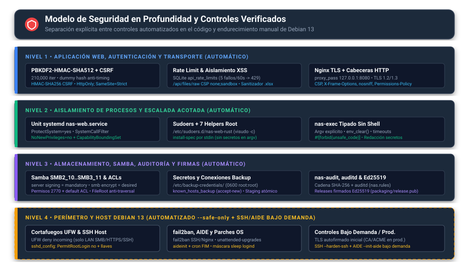

# Seguridad y Endurecimiento del Sistema

> [!IMPORTANT]
> Este documento distingue de forma estricta entre **(1) controles automatizados ya implementados en el código y empaquetado**, **(2) endurecimiento bajo demanda sobre Debian 13** que el administrador puede aplicar en el servidor, y **(3) riesgos/brechas abiertas** sobre la plataforma actual (`v0.1.14`; detalle completo en [docs/deuda_tecnica.md](./deuda_tecnica.md)).

---

## 1. Controles Automatizados en Código y Empaquetado

Los siguientes controles se aplican automáticamente mediante `install.sh`, `packaging/install.sh` y el propio código fuente Rust de `nas-web`, `nas-exec`, `nas-engine` y `nas-audit`.

### 1.1 Autenticación Web, Sesiones y Protección CSRF

Implementados en `crates/nas-web/src/auth.rs`, `db.rs` y `extractors.rs`:

- **Derivación de contraseñas (`PBKDF2-HMAC-SHA512`):** `210,000` iteraciones con *salt* aleatorio de 16 bytes en formato `$pbkdf2-sha512$`, implementado sobre `hmac` y `sha2` sin dependencias inseguras (`#![forbid(unsafe_code)]`).
  - Incluye **mitigación anti-enumeración por tiempo (*dummy hash*)** cuando el usuario no existe.
  - Si detecta un hash SHA-256 heredado, lo verifica y lo **actualiza automáticamente a PBKDF2-HMAC-SHA512** al primer inicio de sesión exitoso.
- **Protección contra fuerza bruta (*Rate Limiting*):** tabla `api_rate_limits` en `/var/lib/nas/nas.sqlite` (modo WAL). Tras **5 intentos fallidos en 60 segundos**, bloquea la IP/origen con HTTP `429 Too Many Requests`.
- **Cookies seguras:** `HttpOnly; SameSite=Strict; Secure` con TTL configurable (`NAS_WEB_TTL_SECS=28800`, 8 horas).
- **Tokens CSRF (`HMAC-SHA256`):** validados en métodos mutantes (`POST`, `PUT`, `PATCH`, `DELETE`), tanto en formularios previos al login (`login:<ts>`, TTL 7200 s) como ligados a sesión autenticada (`session:<id>`).
- **Control de acceso escalonado (*Extractors*):**
  - `AuthenticatedUser`: lectura y sesión activa.
  - `AdminUser`: operaciones administrativas del panel.
  - `SuperAdminUser`: operaciones críticas reservadas, con respaldo del archivo `/etc/nas/superadmin`.

### 1.2 Aislamiento XSS en Visores y Transporte HTTP

- **Cabeceras Nginx y Middleware `nas-web` (`lib.rs` y `packaging/nginx-nas-web.conf`):** TLS 1.2/1.3, `Strict-Transport-Security`, `Content-Security-Policy` (`default-src 'self'; img-src 'self' data:; style-src 'self' 'unsafe-inline'; script-src 'self' 'unsafe-inline'; frame-ancestors 'self'`, donde `'unsafe-inline'` corresponde a los manejadores locales de Slate UI), `X-Frame-Options: SAMEORIGIN`, `X-Content-Type-Options: nosniff`, `Referrer-Policy` y `Permissions-Policy`.
- **Aislamiento de descargas directas (`/api/files/raw`):** responde con `Content-Security-Policy: default-src 'none'; sandbox` y `X-Content-Type-Options: nosniff`, impidiendo que archivos HTML/SVG subidos por usuarios puedan ejecutar JavaScript bajo el origen del panel.
- **Sanitizador DOM en cliente para hojas `.xlsx`:** en `crates/nas-web/assets/js/modules/files/viewers.js`, la tabla HTML generada por SheetJS pasa por un limpiador DOM basado en lista blanca estricta de etiquetas (`table`, `thead`, `tbody`, `tr`, `th`, `td`, etc.) y atributos seguros, bloqueando `<script>`, `<iframe>` y manejadores `on*`.
- **Protección anti *Path Traversal*:** `FileRoot::resolve` verifica rutas canónicas dentro de `/srv/nas` antes de leer, subir, comprimir o eliminar archivos.

### 1.3 Frontera de Privilegios, `systemd` y Paso Seguro de Secretos

- **Usuario dedicado sin shell de acceso:** el servidor HTTP corre como usuario `nas-web` (grupo `nas-web`, grupo suplementario `grp_samba`).
- **Endurecimiento `systemd` (`packaging/nas-web.service`):**
  - `ProtectSystem=yes`, `ProtectKernelTunables=yes`, `ProtectKernelModules=yes`, `ProtectControlGroups=yes`, `PrivateTmp=yes`, `RestrictNamespaces=yes`, `LockPersonality=yes`, `MemoryDenyWriteExecute=yes`, `SystemCallFilter=@system-service`.
  - `ReadWritePaths=/var/lib/nas /srv/nas /usr/local/bin -/etc/cron.d -/etc/backup-credentials -/etc/samba`.
  - **`NoNewPrivileges=no` acotado con `CapabilityBoundingSet` y `AmbientCapabilities=` vacío:** necesario específicamente para que el binario pueda invocar `sudo -n` hacia la lista blanca de `/etc/sudoers.d/nas-web-rust` sin quedar bloqueado por el bit `no_new_privs`, mientras el servidor web corre sin capacidades ambiente (`AmbientCapabilities=`).
- **Ejecución sin shell (`nas-exec`):** todos los comandos externos se construyen con `CommandSpec` (arreglo explícito `argv`), `env_clear()`, `PATH` fijo, timeouts y redacción automática de secretos en mensajes de error.
- **Sudoers y 7 Helpers Root:** `/etc/sudoers.d/nas-web-rust` (`0440`, validado con `visudo -cf`) restringe `sudo -n` a servicios, `/usr/local/bin/nas --json security status`, `/usr/sbin/realm leave --remove --user *` y los 7 helpers en `/usr/local/sbin/` (`nas-samba-apply`, `nas-share-dir`, `nas-share-acl`, `nas-accounts`, `nas-backup-manage`, `nas-terminal`, `nas-storage-apply`) más `nas helper *` (incluyendo `nas helper files-delete` para envío a papelera `.trash`, eliminación definitiva, restauración y purga privilegiada en `/dashboard#files` mediante `/api/files/delete-privileged` y `/api/files/trash/privileged` tras autenticar credenciales reales `root`/`sudo` vía `stdin`, con rate-limit de 5 fallos/5 min, confirmación `SI-ELIMINAR` en acciones irreversibles, bloqueo estricto de carpetas raíz `BACKUPS_HISTORICOS`/`BACKUPS_PERMANENTES`/`LOGS_BACKUP`/`.nas_staging`/`.tmp_zip`/`.trash`/symlinks, permitiendo depurar contenido interno de `BACKUPS_*` con manejo puntual `lsattr -d`/Btrfs `ro` sin `chattr -R -i` ni alteración de permisos/ACLs).
- **Credenciales de respaldo vía `stdin` y runners validados:** el alta/edición de tareas desde el panel invoca `nas-backup-manage install-spec` pasando la definición JSON y contraseñas/claves SSH por entrada estándar (`stdin`), guardándolas en `/etc/backup-credentials/` con permisos `0600 root:root`. `nas-backup-manage install` re-renderiza el runner exclusivamente desde el `BackupSpec` validado (con `PATH` fijo, `DEST_ROOT` verificado y lista blanca de `PATH` en cron). Nunca se exponen secretos en la lista de argumentos (`ps`).
- **Firmas SSH dedicadas en backups:** los runners generan y usan `/root/.ssh/known_hosts_backup` con `StrictHostKeyChecking=accept-new` (TOFU), protegiendo contra suplantación tras el primer enlace.

### 1.4 Kernel, Samba, Auditoría y Actualizaciones Firmadas

- **Kernel (`packaging/99-nas-tuning.conf` y `packaging/99-nas-journald.conf` → `/etc/systemd/journald.conf.d/99-nas-limits.conf`):** activa `net.ipv4.conf.*.rp_filter=2` (modo laxo RFC 3704, compatible con múltiples interfaces/VLANs), `net.ipv4.tcp_syncookies=1`, `vm.vfs_cache_pressure=100`, `kernel.kptr_restrict=2`, `kernel.dmesg_restrict=1`, `kernel.yama.ptrace_scope=2`, desactiva IPv6 (`disable_ipv6=1`), enmascara objetivos de suspensión/hibernación (`sleep.target`) y limita `systemd-journald` a `SystemMaxUse=256M`.
- **Samba 4:** `server min protocol = SMB2_10`, `server max protocol = SMB3_11`, `server signing = mandatory`, `smb encrypt = desired`, `map to guest = Bad User`, directorios de respaldo `2770` (`BACKUPS_HISTORICOS`, `BACKUPS_PERMANENTES`, `LOGS_BACKUP`, con soporte para recursos ocultos `$`) y permisos POSIX `2770` + `default ACL`.
- **Auditoría triple:**
  1. `web_audit` en SQLite con usuario e IP de origen (`origin_ip`).
  2. `nas-audit` (*append-only*) con cadena criptográfica SHA-256 verificable (`nas audit verify`).
  3. `auditd` (`packaging/nas.rules` -> `/etc/audit/rules.d/nas.rules`) vigilando `/etc/sudoers`, `/etc/sudoers.d`, `/etc/samba/smb.conf`, `/etc/backup-credentials/` y `/usr/local/sbin/nas-terminal`.
- **Actualizaciones firmadas `Ed25519`:** `nas update` verifica el hash `SHA-256` del paquete y la firma `Ed25519` contra `packaging/release.pub` antes de desplegar en el slot A/B.

---

## 2. Endurecimiento del Host Debian 13 (Automatizado y Manual Opcional)

> [!NOTE]
> `install.sh`, `packaging/install.sh`, `nas deploy apply` y `nas update apply` ejecutan `nas security harden --apply --safe-only` para sincronizar el cortafuegos `ufw` (backend `iptables-nft` con detección LAN y regla anti-lockout sobre `$SSH_CONNECTION`), `fail2ban` (`backend = systemd`), `unattended-upgrades`, reglas `auditd`, exclusiones `aide`, `nas-web.service` sin `AmbientCapabilities`, `sudoers` validado con `visudo -cf` y máscara ACPI.

| Control | Paquete / Archivo en Debian 13 | Objetivo de Seguridad | Estado por Defecto Tras `install.sh` / `nas update` |
| :--- | :--- | :--- | :--- |
| **Cortafuegos `UFW`** | `ufw` (`/etc/default/ufw`, reglas LAN) | Política `deny incoming`; abrir solo `22/tcp`, `80/443/tcp`, SMB (`139,445/tcp`, `137,138/udp`) y `wsdd2` (`3702/udp`, `5355/tcp,udp`, `5357/tcp`) restringidos a la subred LAN; fijar `IPV6=no` y preservar `$SSH_CONNECTION`. | **Automatizado** (respeta reglas previas si ya está activo, salvo `--force-fw`). |
| **Endurecimiento SSH** | `/etc/ssh/sshd_config.d/99-nas-hardening.conf` | Fijar `PermitRootLogin no`, exigir llaves públicas (`PasswordAuthentication no` tras validar llaves), `X11Forwarding no`. | **Bajo demanda** (`sudo nas security harden --apply --harden-ssh` cuando exista `authorized_keys` en cuentas interactivas no-`root`, ignorando `nologin`/`false`). |
| **Prevención de intrusiones** | `fail2ban` (`/etc/fail2ban/jail.d/nas.local`) | Bloqueo automático de IPs por intentos repetidos en `sshd` (`backend = systemd`, `banaction = nftables`). | **Automatizado** en `install.sh`, `nas deploy` y `nas update`. |
| **Parches automáticos OS** | `unattended-upgrades` (`/etc/apt/apt.conf.d/20auto-upgrades`, `51nas-unattended-upgrades`) | Instalación automática de parches de seguridad de Debian 13 sin reinicios automáticos inesperados. | **Automatizado** en `install.sh`, `nas deploy` y `nas update`. |
| **Integridad de archivos (FIM)** | `aide` (`aideinit`, base `/var/lib/aide/aide.db`, exclusiones `packaging/75_aide_nas`) | Línea base criptográfica de binarios y `/etc` para detectar rootkits o alteraciones fuera de banda excluyendo `/srv/nas`, `/var/lib/nas` y desarrollo. | **Exclusiones automatizadas**; inicializar base con `--init-aide` o `aideinit`. |
| **Anti-suspensión ACPI** | `systemd` (`systemctl mask sleep.target suspend.target hibernate.target hybrid-sleep.target`) | Evita que el servidor entre en suspensión por botones físicos o políticas `logind`. | **Automatizado** en `packaging/install.sh`, `nas deploy apply` y `nas update`. |
| **Protección eléctrica (UPS)** | No-Break / `nut` (Plug & Play opcional en `/dashboard#storage`) + supresor de picos + SSD con PLP en `/` | Evita corrupción FTL y bloqueo en solo lectura desde el controlador tras cortes de energía en hardware consumidor. | **Integrado en panel (`nut` bajo demanda) y recomendado para producción.** |
| **Certificado TLS definitivo** | `/etc/ssl/certs/nas-web.crt` y `.key` | Reemplazar el certificado autofirmado inicial generado por `packaging/install.sh` por uno emitido por la CA corporativa o ACME. | **Autofirmado** (generado por 3650 días en `packaging/install.sh`). |

Los comandos concretos para verificación o endurecimiento adicional (`nas security status`, `--harden-ssh`, `--init-aide`) figuran en [docs/manual.md](./manual.md).

---

## 3. Estado de Brechas y Riesgos Operativos (`v0.1.14`)

La auditoría inicial sobre `0f7a272` ([docs/auditoria.md](./auditoria.md)) registró hallazgos críticos resueltos en `v0.1.11`–`v0.1.12` (`system_update_run` vía `systemd-run`, unificación de plantillas `packaging/` ↔ `deploy/` vía `include_str!`, `su root grp_samba` en `logrotate`, actualización de `web_users` en `packaging/install.sh` y sincronización post-update).

**Riesgos operativos vigentes y registro de deuda técnica:**
1. **Certificado TLS autofirmado por defecto:** requiere aceptación manual o sustitución por certificado emitido por CA interna / ACME en producción.
2. **Actualización desde versiones `<= 0.1.10`:** en servidores instalados antes de `v0.1.11`, el primer paso debe hacerse por consola (`sudo rm -f /var/lock/nas-update.lock` si quedó huérfano, `sudo nas update apply --repo ftole/nas_debian --yes` y `sudo bash /opt/nas_debian/current/packaging/install.sh`) para aplicar la nueva regla `sudoers` de `nas-system-update`.
3. **Brechas abiertas en código actual:** las brechas críticas de seguridad (`DT-C01`, `DT-C02`, `DT-C07`), altas de seguridad (`DT-A01`–`DT-A07`) y medias (`DT-M03`, `DT-M05`) quedaron remediadas; el resto de hallazgos funcionales/deuda estructural están registrados en **[docs/deuda_tecnica.md](./deuda_tecnica.md)**.

---

## 4. Automatización del Endurecimiento en Rust (`nas security`)

> [!NOTE]
> **Estado: Implementado.** `nas security status | harden` sincroniza los controles en instalación (`packaging/install.sh`), despliegue (`nas deploy apply`) y actualización (`nas update apply`).

- **Paquetes y controles sin riesgo de bloqueo:** auto-aprovisionamiento de `ufw`, `fail2ban`, `unattended-upgrades` y `aide`; configuración de `fail2ban` (`/etc/fail2ban/jail.d/nas.local` con `backend = systemd`), parches automáticos sin reinicio forzado, máscara ACPI (`sleep`/`suspend`/`hibernate`/`hybrid-sleep`), exclusiones AIDE y sincronización de `nas-web.service` (`AmbientCapabilities=` vacío) + `sudoers` validado con `visudo -cf`.
- **Cortafuegos `ufw` con protección anti-lockout:** autodetección de subred LAN (anulable con `NAS_LAN_CIDR` / `--lan-cidr`), preservación de acceso `22/tcp` para la IP origen de `$SSH_CONNECTION` y respeto de reglas existentes cuando `ufw` o `nftables` ya estén activos (salvo `--force-fw`).
- **Endurecimiento SSH seguro:** drop-in `/etc/ssh/sshd_config.d/99-nas-hardening.conf` validado con `sshd -t` (rollback automático ante fallo) bajo bandera explícita `--harden-ssh` y únicamente si existen llaves válidas en `authorized_keys` de usuarios interactivos no-`root` (excluyendo cuentas `nologin`/`false`).
- **Equipos ya desplegados:** soporte `--safe-only` (invocado automáticamente por `nas update`) / `--init-aide` y comando explícito `sudo nas security harden --dry-run` / `--apply`.
